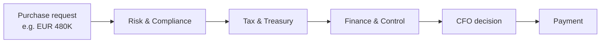
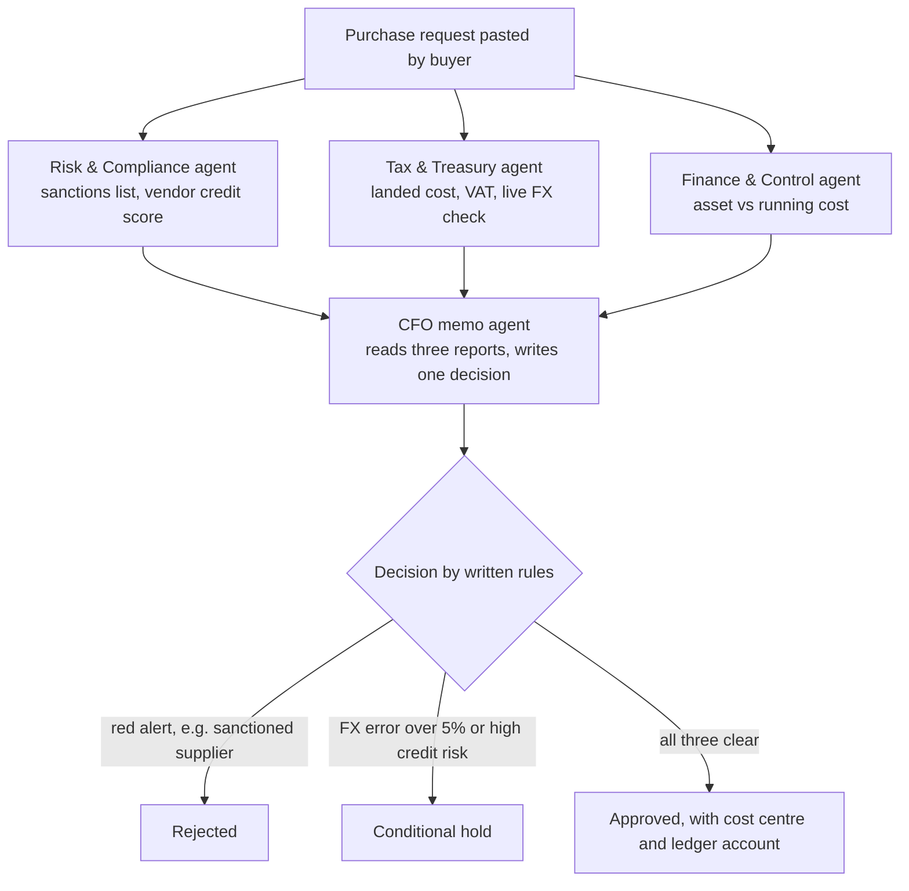
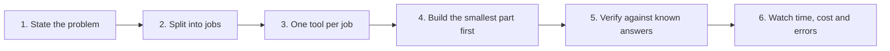
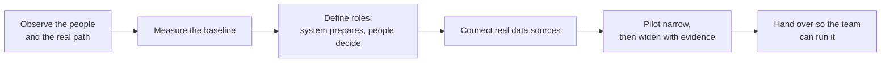
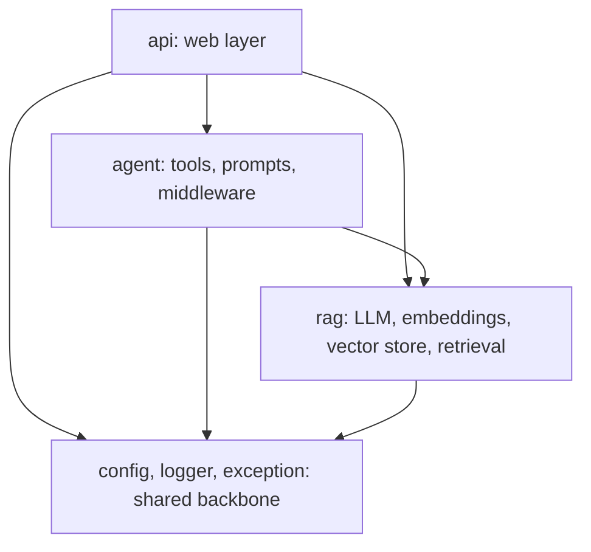

# 🏗️ Before You Write a Line of Code: Kicking Off Meridian AI, an Enterprise RAG + Multi-Agent Project

### 📋 Agentic AI 3.0 Specialization | Krish Naik Academy

**🎙️ Mentor:** Mayank Aggarwal
**⏱️ Duration:** ~4 hours | **📅 Session:** Saturday, 10 October 2026
---
Code Repository: https://github.com/mayank953/meridian-ai-learner

---

Most AI projects fail before the first prompt is written, because the team never agreed on what problem the system solves, who uses it, and what it must *not* do. This session starts a three-session project, **Meridian AI**, and deliberately spends its first hour on the company and the problem. Only then does it move to tooling and a from-scratch project skeleton.

This article follows that same order: the problem, the solution scope, two engineering lenses (AI engineer and forward deployed engineer), and finally the project setup.

---

## 🏢 The Case: Aldermore Industries

Aldermore Industries is a fictional machine builder headquartered in Hamburg with 40+ subsidiaries worldwide. It makes machines that pack bottles and boxes, and it buys servo motors, controllers, sensors, steel, food-grade chemicals and packaging material from suppliers around the world.

It is fictional by design, but it follows a pattern real companies share: **many suppliers, strict internal rules, and documents that hold the answers.**

### Four checks before any payment

Every purchase request passes four departments, always in this order. Payment and the CFO decision come last, never first.



Each department has its own question and its own written rules:

| Department | Question it answers | Example rules |
|---|---|---|
| **Risk & Compliance** | Is this supplier safe to deal with? | Screen against sanctions lists; credit score 75+ is low risk, 50–74 needs a deposit or letter of credit, below 50 escalates to the CFO |
| **Tax & Treasury** | What will it really cost, and is the FX rate fair? | 19% German import VAT, customs duty by tariff code, quoted exchange rate must be within 5% of the market rate |
| **Finance & Control** | How is it booked, and who must sign? | Asset (capex) vs running cost (opex); above EUR 250K the department head also signs; above EUR 1M the CFO and management board are involved |
| **CFO** | Final yes or no | Reads the three reports and decides |

### Why it is a bigger problem than it looks

One EUR 480K order lands in four inboxes in sequence. Each stop is a person with other work, so the cycle is measured in **days, not minutes**. Beyond slowness, four pains compound:

- **Slow:** every department checks in turn while the request waits in someone's inbox.
- **Hidden rules:** payment terms, approval limits and tax rules live in long PDFs.
- **Inconsistent:** two buyers can get two different answers to the same question, depending on who read which document and when.
- **No record:** when an auditor asks why something was approved, nobody remembers.

The cost of a miss is concrete: paying a sanctioned supplier, booking an asset as a running cost, accepting an off-market exchange rate, or being unable to explain a decision to an auditor.

### Why the obvious fixes fall short

| Fix | What it gives | What it leaves open |
|---|---|---|
| Reminder emails | A little speed | Rules still hidden, answers still differ |
| Shared folder of PDFs | Findable rules | Someone must still read and apply them |
| General chatbot | Fast, fluent answers | It has never seen Aldermore's documents and cannot check a sanction list. Uploading internal documents to a public chatbot is also a data-security risk |
| Fixed code only | Consistency | It cannot read PDFs or judge whether a supplier looks risky |

A useful mental model: **an AI model alone is a brilliant new hire on day one.** It is smart, but it has never seen your files and cannot pick up the phone. The engineering job is to give it the files (retrieval) and the phone (tools).

---

## 🎯 The Solution: Two Helpers, One Application

Meridian AI is one application with two features and four screens.

**1. Document Helper (RAG Q&A).** An administrator uploads policy PDFs, which are chunked, embedded and indexed. Anyone can then ask a question in plain English and get an answer drawn only from those documents. If the answer is not in the documents, the system says it doesn't know. In the demo, asking about import VAT returned 19% for Germany with the intra-EU reverse-charge nuance, while asking who won the last cricket World Cup produced "I don't know based on the provided context."

**2. Audit Helper (multi-agent).** A buyer pastes a purchase request. Specialist agents then work in sequence:



The decision follows **keywords in the specialist reports, not the model's mood**. This standardisation is what makes it defensible in a company.

In the live demo, a PLC order was submitted with a EUR/JPY rate of 63.5, against a market rate near 177 (±5% is roughly 168–185). The Tax & Treasury report flagged a severe FX breach. The final CFO memo carried the finding and a 48-hour action to investigate and hedge.

### Four lines to remember

> Two helpers in one application. Decisions follow written rules. People stay in charge. The system knows its limits.

### What it deliberately does not do

Defining non-goals matters as much as defining goals, and it is a habit worth taking to real client work. The scope for this first version:

- Four of five checks rely on the model's general knowledge. A real deployment would connect real sanction, credit and tax sources. **Only the exchange-rate check uses live data.**
- The document Q&A and the audit are **separate features**. Uploaded documents do not influence audit decisions, because otherwise anyone could upload a document to sway a procurement decision. Policy changes must come from the source.
- AI wording changes between runs, and a person reviews important decisions.
- There is **no sign-in** in this version; a real deployment needs roles (admin, CFO, buyer) and an approval trail security will accept.
- Upload history lives in memory and resets on server restart.
- Only text PDFs work. Scanned images need OCR first.
- No MCP and no evaluation framework in this project. Those are reserved for later projects, so each project teaches one thing well instead of sprinkling in every technology.

The UI is intentionally plain. For a system that a whole company will use, simple things scale.

### The stack

Python, FastAPI, React, Docker, Google Cloud, GitHub, with **Gemini** as the model and **LangChain** as the toolkit. The plan is to run everything locally first, then deploy to GCP.

---

## 🧭 Two Lenses on One Project

### The AI engineer's route

The AI engineer designs, builds, tests and ships the AI part of a system and proves it works. The recurring questions are: *Is it correct? Is it safe? Can we test it? What will it cost?* The route has six steps.



**Start with the problem, not the model.** The sentence that governs the whole project: *make the checks faster, make them consistent, leave a written record, and don't take the decision away from people.* If a part of the system doesn't serve that sentence, it isn't built. Starting from "I'll use Claude or OpenAI" is where most projects go wrong.

**Break it into jobs rather than writing one giant prompt.** A single prompt is hard to test, costly, hides its sources, and a failure could be anywhere inside it. With one tool per job (search, risk, tax, control, decide, log), each part is tested alone, and a failure has an address.

| Job | Technique |
|---|---|
| Find the right passage | Search documents by meaning (RAG) |
| Check from several angles | Specialist agents, each with their own tools |
| Decide by written rules | Keywords and thresholds in code |
| Let people use it | Front end and APIs |
| Make it trustworthy | Logs, clear errors, limits, tests |
| Package and ship | Dockerfile and deployment |

**Search first, then answer.** The RAG pipeline: split documents into pieces, search by meaning, take the best three, and have the model write from them or say "I don't know". Pasting every document into every prompt is slow, expensive, and leaves no visible source.

**Exact rules belong in code; judgment belongs to the model.** A threshold such as "variance above 0.05 raises an FX alert" is checkable and belongs in ordinary code. Asking a model to apply it in a prompt is an engineering failure. The same goes for masking emails and card numbers before text reaches the model. Use the model for judgment calls such as "does this supplier look risky?" or "is this item a lasting asset?".

**Build the smallest thing first.** The progression: notebook sketch, then functions with clear inputs and outputs, then one file per job, then settings moved outside the code, then a safety layer of logs, errors and tests. It still runs at every step.

**Verify against known answers.** The project ships with 17 automated tests. If you know the German import VAT is 19%, a test pins it so a confident wrong answer (say, 25%) is caught.

**Three things to watch:**

1. **Time and cost.** An audit took roughly 70–150 seconds in testing and made many model calls, so cap it.
2. **Confident mistakes.** A model states a wrong thing as fluently as a right one. Tests on numbers you are sure of are the defense.
3. **Rules hidden in text.** The final decision rule must be checked by keyword in code, not live only inside a prompt.

### The forward deployed engineer's route

An FDE (forward deployed engineer) works inside the customer's organisation to turn a working system into daily use. An AI engineer's job ends at a tested, working service. The FDE's job continues until the system is **adopted, trusted and handed over**. The AI engineer might never meet the users; the FDE sits with them. A useful shorthand: FDE ≈ AI engineer + consultant.



- **Observe.** Sit with a buyer, a tax specialist and a controller and ask them to show what they did yesterday. Find the real path, not the one on the process chart: which step holds the order longest, what comes back, and which repeated question the old system couldn't answer.
- **Measure the baseline first.** Days from request to payment, hand-offs between people, requests sent back to the buyer, decisions nobody can explain later. Without a baseline, "it feels faster" is only an opinion; with one, the result is a number.
- **Define roles.** The system looks up rules, runs checks, resolves holds and writes the memo. People approve the payment, handle exceptions the rules don't foresee, and own the policy.
- **Connect real data.** In this project, sanction lists and tax tables come from model memory. Grounding matters: the model's general knowledge put customs duty on a Japanese PLC controller at 0%, while Aldermore's own tariff document said 2.2%. Connecting the audit to the document that holds the answer fixes this, and the FDE is the one who asks the tax team which source is right.
- **Start narrow, then widen.** One category, one team, a few real users, even if rough. Watch how they actually use it, fix, measure against the baseline, and widen only with evidence.
- **Respect the customer's rules.** Privacy (redact emails, mask cards), access (a real deployment needs sign-in and approval rules security will accept), and cost (some cloud services bill by the hour even when idle, so agree a budget, set an alert, and know how to switch everything off).
- **Hand over.** Every audit leaves a record so an auditor's "why was this approved?" has an answer. The customer's team should be able to run the system, change a prompt, read the logs and switch it off.

### Side by side

| | AI engineer | Forward deployed engineer |
|---|---|---|
| Starts from | A defined problem and some data | People, process and constraints |
| Main question | Does it work, and can we prove it? | Will people use it and trust it? |
| Spends time on | Prompts, tools, retrieval, tests | Observation, data access, rollout, handover |
| Delivers | A tested working system | A system in daily use plus a handover |
| Success looks like | Correct, fast, affordable | A measured gain against the baseline |

The overlap is large and the FDE role is still evolving. It is typically on top of a solid AI engineering base, which is why a tech background is the practical entry point. This project is structured so both views can be practised.

---

## 🛠️ Setting Up the Project from Scratch

Even though the finished code is already in a shared repository, the setup is rebuilt from an empty folder. The point is to understand *why each file exists*, since starting a project from nothing is rare in the AI world and is a skill in itself.

### What lives in a project folder

| Item | Purpose | In Git? |
|---|---|---|
| Code (`.py`) | Instructions the computer runs | Yes |
| `.env` | Real secrets: API keys, passwords | **Never** |
| `.env.example` | Template listing the variable names, no real values | Yes |
| Sample documents | Input data (replace with your own) | Yes |
| `requirements.txt` | Shopping list of packages | Yes |
| README | Documentation for people | Yes |
| `.venv/` | Virtual environment, generated | **Never** |

Note that `.env` (environment variables, often secrets) and `.venv` (the virtual environment) are two unrelated things that look alike.

The workflow for a newcomer: copy `.env.example` to `.env`, fill in real values locally, and let the program read them as environment variables. A `.gitignore` entry keeps `.env`, `.venv` and generated folders like logs out of GitHub. In deployment, secrets move to a secret manager instead.

### Git, GitHub, and friends

**Git** is a version-control system, created by Linus Torvalds (also the creator of Linux). It works locally and tracks the history of a folder. **GitHub, GitLab and Bitbucket** are platforms built on top of Git that host repositories so people can share them. The core loop is `git add`, `git commit` with a message, and `git push`; a *fork* is your own copy of someone else's repository.

### Front end and back end

The **front end** is what you see in the browser (here, a React app). The **back end** is the engine: Python and FastAPI exposing endpoints such as `POST /api/rag/ask`, exchanging JSON. The two are separate by design. In the demo, killing the back-end server left the front end running but every question failed with an error, visible in the browser's network tab as a failed call to the API.

### Why `uv`

The older routine was to create a virtual environment, activate it, and `pip install`, and it was easy to forget a step or open a new terminal outside the environment. **`uv`** manages the Python version, the environment and the packages in one tool, and is faster. `uv run` automatically uses the project's environment, so there is nothing to activate.

Tooling needed: **Git, uv, Python 3.12, an editor such as VS Code, Node.js 20+ (for the front end), and a Gemini API key.** Python 3.12 was chosen over the very latest release, since a version or two behind is more stable for real work.

```bash
uv python install 3.12
mkdir meridian-ai && cd meridian-ai
uv init            # creates pyproject.toml and .python-version
```

`pyproject.toml` holds the project name, version, required Python and dependencies; `.python-version` pins exactly 3.12 so uv always picks it up.

### Pinning dependencies, and why two requirements files

AI libraries change fast and can break each other. Pinning exact versions means the project behaves identically on your laptop, a colleague's laptop and a deployed container. The analogy: it is the difference between saying "a Windows that runs this game" and "Windows 7 with DirectX 10".

- `requirements.txt`: what the app needs to run in production (19 direct packages here).
- `requirements-dev.txt`: everything above plus test tools, which don't belong on a live server. The dev file pulls in the first with `-r requirements.txt`.

```bash
uv add -r requirements.txt
uv add --dev pytest==8.4.2 httpx==0.28.1
```

Core libraries and what they do:

| Library | Role |
|---|---|
| `langchain`, `langchain-core` | Agents, middleware, prompts, tools |
| `langchain-community` (PDF loader), `langchain-text-splitters`, `pypdf` | Read PDFs and split into chunks for RAG |
| `langchain-google-genai` | Connect to Gemini |
| `langgraph` | The engine under LangChain's agent creation; no graph code written directly |
| `chromadb`, `langchain-chroma` | Local vector store |
| `langchain-google-vertexai`, Google Cloud Storage | Cloud embeddings and file storage, used when moving to GCP |
| `pydantic`, `pydantic-settings` | Validate request shape; read settings from `.env` |
| `python-multipart` | Receive uploaded files |
| `requests` | Live exchange-rate call |
| `pytest`, `httpx` (dev) | Tests; `httpx` powers FastAPI's test client |

After installation, three artefacts matter:

- **`pyproject.toml`**: what you asked for.
- **`uv.lock`**: exactly what was installed, here 157 packages and about 4,000 lines, never hand-edited. It is what makes someone else's install identical to yours.
- **`.venv/`**: the private environment (~590 MB here). It is disposable: delete it, run `uv sync`, and it is rebuilt from the lock file. That is why it never goes to GitHub.

A quick proof that `uv run` uses the project environment rather than the system Python: the same version-printing script reports an older LangChain under plain `python` and the newer pinned one under `uv run python`. Importing a library that is only on the system (such as Crew AI) fails inside the project environment. If you see "No module named fastapi," you ran plain Python outside the environment; use `uv run`.

### Structure: one file, one job

Putting everything in one file means hard-to-find code, changes that break unrelated things, code that is hard to test alone, and merge clashes. Splitting by responsibility gives every piece of code a home before it is written.

```
backend/
├── config/      settings (read from .env)
├── exception/   custom errors
├── logger/      logging
├── rag/         llm, embedding, vector_store, document_store, data_ingestion, retrieval
├── agent/       tools, prompts, middleware, agents
├── api/         schemas, endpoints, main (FastAPI app)
└── tests/
```

The `__init__.py` file makes a folder a Python package so it can be imported elsewhere. The tests folder doesn't need one.

**Who may use whom** is the rule that keeps the layers clean:



The API uses everything below it; agents can use RAG; **RAG never uses agents**. The shared backbone (config, then exceptions, then logger) is built first, because every later step depends on it.

The skeleton, 24 empty files, is created with a single `mkdir -p` plus `touch` command. In practice files are created as the need arises rather than all up front, and the numbers (24, 27, 30) don't matter. After that, secrets and generated folders go into `.gitignore`, and a first commit is made.

Within the API, `main.py` creates the app and plugs in routers for health, status, agent (run an audit) and RAG (upload, ingest, ask). The agent is built lazily on the first audit request rather than at server start, using an LRU cache. Tools such as `check_sanction_list` and `vendor_credit_score` carry their prompts; prompts are pulled into a separate file to keep tools readable.

---

## 🔑 Key Takeaways

- Understand the company, problem and scope **before** choosing technology. It also gives you something real to say in interviews.
- Write down what the system will **not** do; it prevents scope disputes.
- Put exact rules in code and judgment in the model. Never let a threshold live only in a prompt.
- Ground answers in the company's own documents; the model should say "I don't know" rather than guess.
- Keep humans in charge: the system prepares, people decide, and everything is logged.
- Secrets never go to Git. Pin exact dependency versions. Use `uv` to keep the environment reproducible.
- One file, one job; dependencies point one way, and RAG never calls agents.

---

## 🏛️ Enterprise Lens: Mapping This Project to TOGAF and OWASP

*This section is an addition to the class material, connecting what was taught to enterprise-grade architecture practice. The instructor did not present it in these terms.*

**TOGAF alignment**

| Class activity | TOGAF idea |
|---|---|
| Understanding Aldermore's departments, approval limits and pain points first | Business Architecture and stakeholder analysis (Preliminary / Architecture Vision / Phase B) |
| The scope and non-goals list | Architecture Vision and scope statement; requirements traceability |
| "System prepares, people decide" and the written decision rules | Architecture principles and governance |
| Document store, vector store and the document-vs-audit separation | Data Architecture (Phase C) |
| FastAPI, agents, RAG layers and one-way dependencies | Application Architecture (Phase C) |
| Docker, GCP, local-first then cloud | Technology Architecture (Phase D) and Migration Planning (Phases E/F) |
| Baseline, pilot, widen, handover | Implementation Governance (Phase G) and Change Management (Phase H) |

**OWASP alignment (including the OWASP Top 10 for LLM Applications)**

| Class decision or gap | Relevant concern |
|---|---|
| `.env` kept out of Git; secret manager on deploy | Secrets management and cryptographic storage |
| No sign-in or roles yet | Authentication and access control; the lack of them is called out as a real-deployment gap |
| Audit separated from user-uploaded documents | Protection against prompt or data injection through uploaded content |
| Email redaction and card masking before the model | Sensitive information disclosure |
| Humans approve decisions; model only prepares | Excessive agency and over-reliance on model output |
| Exact version pins and `uv.lock` | Vulnerable and outdated components / supply-chain integrity |
| Logging every audit | Security logging and monitoring |
| Hash check to block duplicate uploads | Input validation and resource abuse control |

Treat the gaps (authentication, role-based access, upload validation, rate limits) as the first items to close before any production rollout.

---

## ❓ FAQ

**Do we use LangGraph or LangChain in industry projects?**
Either works. This project uses LangChain because it has been covered in class; LangGraph is already the engine underneath LangChain's agent creation, so it gets installed anyway, and LangGraph will be covered later.

**Will we fine-tune the LLM on the company's documents so it can decide?**
No. The approach is RAG: retrieve the relevant document passages and ground the answer in them. Consistency comes from forcing answers to come from the source and to say "I don't know" otherwise.

**Won't the model give different answers each time?**
Wording can vary, and a person reviews important decisions. What stays consistent is the *basis* of the answer: grounded retrieval from the documents, plus rules written in code for decisions such as the 5% FX threshold.

**Which vector database, and where does the project run?**
A local one (ChromaDB) first, then a move to GCP. Cloud runs cost money, and GCP's free credit is a one-time offer that not everyone has, which is why the project runs fully locally first and cloud deployment is held back until everyone has had time to master the local version.

**What happens if several people upload the same document?**
A hash check will detect duplicates so no unnecessary embeddings are created.

**Is a front-end skill required?**
No. The front end can be written with AI assistance, and the class focuses on the back end.

**Why isn't evaluation or MCP in this project?**
To avoid sprinkling every technology into one project. Evaluation, caching, Redis and MCP are planned for later projects.

**Why use FastAPI and React instead of Streamlit?**
Streamlit suits quick prototypes; real projects need a scalable, feature-rich front end. React lives in its own folder (TypeScript, Vite, shadcn) with its own `package.json`, which is why no React library appears in the Python requirements.

**How do you check for confident mistakes (hallucination)?**
Write tests for numbers you are sure of, such as the German VAT rate, and run them every time.

**How is the latest currency rate obtained?**
Through a live exchange-rate tool call (the Frankfurter API was named). It's the only live-data check in this project.

**Why do we need both `requirements.txt` and `pyproject.toml`?**
They overlap. If everything is in `pyproject.toml`, `uv` can manage it all and `requirements.txt` isn't strictly needed. The requirements files are kept because it is a familiar pip-era convention and shows how to bridge old and new workflows. The dev file is optional to send to production; it exists so tests don't burden the live server.

**How do you decide which version to pin?**
Versions normally settle during development, as you hit and resolve incompatibilities between libraries, and you freeze whatever finally works. In real work today, an AI coding tool or lock file does much of this. Any recent Python (3.11–3.13) is fine; there's no need for the latest.

**What is the business problem in one minute?**
A large company has many internal documents it can't upload to public AI tools and needs grounded answers from, plus a slow multi-department procurement audit. Meridian AI offers a private document Q&A and an AI-assisted audit that speeds up the process and sends a memo to the CFO.

**Do we need an Agent Gateway?**
Not in this project. An agent or LLM gateway was not used. A knowledge-base format such as the one a student's company uses (described as Google's Open Knowledge Format) can be integrated in the same RAG way.

**How should I answer an interview question about processing files that land in a folder, with only local Python?**
Think wider than an incremental refresh. A strong answer describes an event-driven, queue-based design: detect new files (for example with a file-watcher such as Watchdog), place work on a queue, process in order, de-duplicate, and land data in the database. Celery, a Python task queue that runs with a message broker, is one tool, and Kafka is a heavier streaming option. Interviewers are often testing breadth of thinking, not a single correct solution. Python multithreading and async will be covered in upcoming content.

**Are code formatters like Black or Ruff used?**
Not in this project. They help readability and can be added, but they aren't a focus.

**How do you handle document versions when policies change yearly, without re-embedding everything?**
Not covered in depth yet. Options include metadata and chunk-level updates rather than re-embedding whole documents; a dedicated project on this comes later.

**How do you handle multilingual or handwritten supplier documents?**
Get the text in first with OCR, which covers many languages (character recognition is separate from language understanding), then process it.

**How do you extract PDFs that have complex tables?**
For a handful of tables, using an AI model to read them is easier than writing rules, though it can make mistakes. Where tables vary too much for rules, a practical approach is to flag complex tables with a script and keep them out of the RAG pipeline.

**Should images be embedded directly with multimodal embeddings?**
Not recommended here. Extracting text from the image (OCR), storing it with the image path in metadata, and retrieving the text for display works better.

**Will domain knowledge be tested in interviews?**
Interviewers care about the projects you have done. Knowing the business context of your project lets you describe it naturally. Domain depends on your company, and there is no need to chase a particular one.

**How do I justify technology choices such as ChromaDB, an embedding model, or an LLM in an architecture interview?**
Tie each choice to requirements: scale, cost, intelligence, security and what the company already runs. Need caching, use something like Redis; files arriving continuously, use a queue; and so on. If your employer restricts you to certain tools, explain how they map to open-source equivalents. This judgment comes mostly from building and hitting real problems; embedding models are often chosen by starting with a known option and improving if answers are poor.

**Can an AI engineer become an FDE, and can a beginner start there?**
An AI engineer is a strong candidate. For someone new to the field it is a long road, since the role builds on AI engineering and needs a solid tech background.

---

## 🗺️ What's Next

- The next session builds the backbone (settings, keys, environment variables, config, exceptions, logger) and runs the project locally. Cloud deployment to GCP comes after local mastery.
- The plan is roughly three sessions for this first project, then further projects before Diwali, and LangGraph afterwards.
- Slides and code will be shared separately.

## ✅ Action Items

- [ ] Go through the shared repository code, which the next sessions rely on
- [ ] Install Git, `uv`, Python 3.12, an editor and Node.js 20+
- [ ] Get a Gemini API key
- [ ] Rebuild the skeleton: `uv init`, add dependencies, create the folder structure, and make a first commit
- [ ] Revise virtual environments vs `.env` if unclear
- [ ] Create a GCP account (free-credit trial) ahead of the cloud sessions

---

*📝 Article compiled from the full transcript of the 10 October 2026 session, Agentic AI 3.0 Specialization, Krish Naik Academy.*
