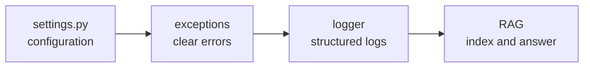
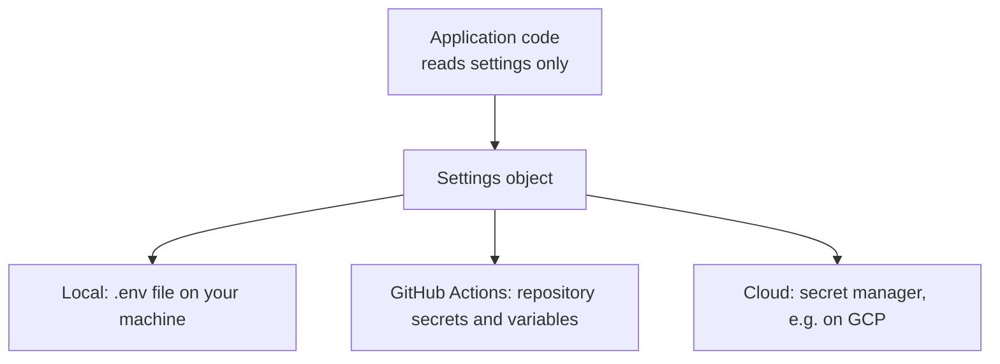
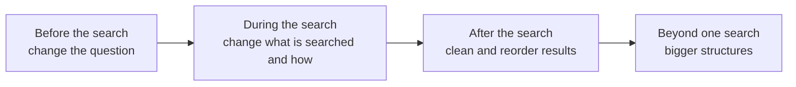

# ⚙️ Config, Errors, Logs and RAG: Building the Backbone of Meridian AI

### 📋 Agentic AI 3.0 Specialization | Krish Naik Academy

**🎙️ Mentor:** Mayank Aggarwal
**⏱️ Duration:** ~4 hours | **📅 Session:** Sunday, 11 October 2026

---

## 📰 Quick Updates

- The slide deck is a running React application rather than a PowerPoint file, so it has to be exported before it can be shared. It is promised for the following day, via the GitHub repository.
- The reference code is a separate repository (`meridian-ai-learner`) that runs fully in **local mode**, with about 98% of the code unchanged from what was shared earlier. Learners are expected to build their own repository, using the reference folder to copy files from.
- Next sessions may run longer, and a dedicated RAG project (evaluation, caching, metadata, document updates) is planned later.

---

## 🧭 The Plan for This Session

The previous session set up an empty project skeleton. This one fills in the **backbone** that every later file depends on, in the build order config → exceptions → logger, and then explains RAG properly, because the project's document Q&A depends on it.



---

## 🔐 Part 1: Settings, or Why Nothing Is Hard-Coded

### Three ways hard-coded values hurt

1. **A key in code, pushed to GitHub, is public for good.** A found key can be used by anyone.
2. **A value repeated in many places drifts.** Change the model name in six of seven files and the seventh breaks the app.
3. **"Works on my machine."** Paths, keys and choices differ between you and a colleague.

The remedy is one place for everything that changes, kept outside the code.

### The three files

| File | What it is | In Git? |
|---|---|---|
| `.env` | Real values for your machine, including secrets | **No** (listed in `.gitignore`) |
| `.env.example` | Template with every variable name and no real values | Yes |
| `settings.py` | One class that reads, types and validates the values | Yes |

A newcomer copies `.env.example` to `.env` and fills in their own values. Variants such as `.env.dev` or `.env.prod` work the same way; the code just has to reference the right file. The same applies to the virtual environment folder, which is generated and never pushed.

### How values reach the code in each environment



The goal is the same everywhere: the code receives environment variables and never needs to know where they came from. Because `.env` is not pushed, the cloud needs its own way to supply the values. GitHub offers secrets and variables for repositories and environments, and GCP has a Secret Manager. These are two of many options.

### The local ↔ cloud toggle

One variable, `APP_MODE`, switches the whole application between two worlds:

| | `APP_MODE=local` (default) | `APP_MODE=cloud` |
|---|---|---|
| Vectors | Chroma, saved under `./.meridian/chroma` | Vertex AI Vector Search |
| Files | `./.meridian/uploads` | Cloud Storage bucket |
| Embeddings | Gemini API (API key) | Vertex AI (Google Cloud credentials) |
| Needs | Only a Gemini API key | GCP project, bucket, service account or workload identity |

Every module that touches storage asks `settings.is_cloud` instead of guessing. On a cloud platform such as GitHub Actions or a deployed service, the person deploying only has to set that one variable from outside. The mentor also noted that "hybrid" modes (some things from cloud, some local) are common in real apps, but this project deliberately supports exactly two.

### Reading `settings.py`

The file is built on Pydantic's `BaseSettings`, which reads each field from environment variables and the `.env` file, applies a default and a type, and rejects bad values. These are the key excerpts from the reference repository (shortened):

```python
PROJECT_ROOT = Path(__file__).resolve().parents[2]   # backend/config/ -> project root

class Settings(BaseSettings):
    app_name: str = "Meridian AI - Procurement Intelligence"
    app_env: str = Field("local", validation_alias="ENVIRONMENT")
    app_version: str = "1.1.0"

    # The toggle: anything other than these two values fails at startup
    app_mode: Literal["local", "cloud"] = Field("local", validation_alias="APP_MODE")

    GOOGLE_API_KEY: str = Field("", validation_alias="GOOGLE_API_KEY")
    llm_model_name: str = Field("gemini-3.8-flash", validation_alias="VERTEX_LLM_MODEL_NAME")
    llm_temperature: float = Field(0.0, validation_alias="LLM_TEMPERATURE")

    embedding_model_name: str = Field("text-embedding-005", validation_alias="VERTEX_EMBEDDING_MODEL_NAME")
    local_embedding_model_name: str = Field("gemini-embedding-001", validation_alias="LOCAL_EMBEDDING_MODEL_NAME")
    embedding_dimensions: int = 768

    agent_max_model_calls: int = Field(8, validation_alias="AGENT_MAX_MODEL_CALLS")
    agent_max_tool_calls: int = Field(6, validation_alias="AGENT_MAX_TOOL_CALLS")
    agent_max_retries: int = Field(2, validation_alias="AGENT_MAX_RETRIES")

    model_config = SettingsConfigDict(
        env_file=str(PROJECT_ROOT / ".env"),   # found no matter which folder you start from
        env_file_encoding="utf-8",
        extra="ignore",
    )

    @property
    def is_cloud(self) -> bool:
        return self.app_mode == "cloud"

settings = Settings()   # one shared object; every other file imports this
```

What each piece buys you:

- **`Path(__file__).resolve().parents[2]`** climbs from `backend/config/settings.py` up to the project root, so `.env` is found from any working directory.
- **`validation_alias`** lets the Python attribute name differ from the environment variable name (`app_env` in code, `ENVIRONMENT` in `.env`).
- **`Literal["local", "cloud"]`** is ideal for a switch. A typo like `hybrid` fails at startup, not later in the middle of a request.
- **Types do conversion.** `LLM_TEMPERATURE=0.0` is text in `.env` and a float in code.
- **No secret in code.** The API key default is empty; the real value comes from `.env`.
- **Embedding dimensions match.** The cloud model must output 768 dimensions to fit the Vector Search index, and the local one is set to 768 as well so both modes behave alike.
- **Agent limits live here too.** The agent middleware caps model calls (8), tool calls (6) and retries (2), and these can be changed without redeploying code. The 70–150 second audits from the previous session make such caps worthwhile.
- **Changing a value is a deployment-free change.** A new Gemini model or a rotated API key is a variable update, not a code release.

The remainder of the file, covered more briefly in class:

- A `model_validator` that makes sure the cloud storage prefix ends with `/`, which Vector Search expects.
- Helper properties `chroma_dir` and `local_upload_dir`.
- `missing_cloud_settings()`, which lists cloud values still empty (project ID, bucket name, index ID, endpoint ID) so errors are clear.
- A block that, in cloud mode on a laptop, points Google's client libraries at a service-account key via `GOOGLE_APPLICATION_CREDENTIALS`. On Cloud Run nothing is set, because the service's own identity is used.

### Getting and using a Gemini API key

1. Open **Google AI Studio**, go to the keys page, and create a key for the project.
2. Paste it once into `.env`. Treat it like a password: never put it in code, chat or a screenshot, and use a throwaway key for recordings.
3. The free tier has request-per-minute, token and request-per-day limits, and free-tier content may be used by Google to improve its products. **Use only the fictional sample documents.**

The key and the model are tied to the code that calls them. A Vertex AI credential is not a Gemini API key, and switching to Grok or OpenAI means changing the model-creation code, although LangChain's chat-model abstraction keeps that change small. Using GCP in this course also keeps the work consistent with deployment later; AWS Bedrock is planned for a later project.

### Proving it works

Two quick checks run inside the project environment with `uv run`:

```bash
cd backend
uv run python -c "from config.settings import settings; print(settings.app_mode)"   # local
```

Then a smoke test that uses only the settings object to call Gemini (reconstructed from the class walkthrough):

```python
from config.settings import settings
from langchain_google_genai import ChatGoogleGenerativeAI

llm = ChatGoogleGenerativeAI(model=settings.llm_model_name,
                             google_api_key=settings.GOOGLE_API_KEY)
print(llm.invoke("hello"))
```

With the key present, the model replies. Deleting the key from `.env` produces an "unauthenticated" error, and restoring it fixes the call, which shows the value really does flow from `.env` through `settings` into the code. Setting `APP_MODE` as an environment variable from the shell overrides the file, which is what a deployment platform does.

---

## 🚨 Part 2: Errors Users Can Understand

A raw stack trace is a wall of text where it is unclear whether the cause is a bug or a missing setting. The pattern: **clean errors for users, a diary for developers.**

Custom exceptions give each failure a type, so the API can map it to a clear HTTP answer:

```python
class MeridianError(Exception): ...          # base class for all project errors
class ConfigurationError(MeridianError): ... # e.g. empty Google API key  -> HTTP 503
class IngestionError(MeridianError): ...     # e.g. PDF could not be read -> HTTP 422
# anything else -> HTTP 500
```

Subclassing from one base lets code catch "any Meridian error" in one place, and a one-line test confirms `issubclass(ConfigurationError, MeridianError)` is true. Using your own error types and status codes in a complex project lets logic branch on the kind of failure, instead of relying on defaults.

---

## 📒 Part 3: Structured Logging

A plain print statement gives you text; a **structured log line** gives you fields you can search, such as an event name, a duration in milliseconds and a severity. Example event: *tool call finished, validate FX, 105 ms.*

What the custom logger does:

- **JSON lines**, one event per line, with an ISO timestamp in UTC, a level, an event name, and the full traceback as a field when an exception occurs (built on `structlog` processors).
- **A `severity` field** copied from the level in uppercase, because Cloud Logging uses that name to colour and filter lines. Production usually shows warnings and errors; development shows everything.
- **Console and file output together**, so the same line appears on screen and is saved. One log file is created per run, in a `logs/` folder, named with the run's date and time.
- **Cloud flush on exit.** In cloud mode only, an `atexit` hook copies the file to the Cloud Storage bucket at shutdown. In local mode it does nothing.
- **One shared logger** (`get_logger("meridian-backend")`) imported everywhere, so every module logs the same way.

Running a one-line import of the global logger and logging an info message creates the `logs/` folder and a timestamped file, which is the proof it works. `logs/` is added to `.gitignore`. Custom loggers like this are standard in company codebases and are often inherited rather than written from scratch; the point of reading one is to know what a good one contains. Since logs are small, no memory management is needed for them.

The backbone is now done: settings, typed errors, and structured logs. The next step is connecting to Gemini and turning text into numbers.

---

## 📚 Part 4: RAG, Explained Properly

### Why a model needs help

A model cannot know your documents. Asked what payment terms servo-motor suppliers get at Aldermore, it gives a generic answer, or asks clarifying questions. Give it the relevant page plus an instruction such as *use the retrieved context to answer, say you don't know if the context doesn't contain it, keep the answer concise*, and the answer becomes exact and company-specific.

**RAG (Retrieval-Augmented Generation)** means *retrieve first, then generate*, like an open-book exam: find the page, then write the answer. It works for any task over documents, not just internal company questions.

### The two stages

```mermaid
flowchart TD
    subgraph Stage 1: Indexing, before any question
    P[PDF] --> R[Read pages<br/>keep file name]
    R --> C[Cut into chunks<br/>~1000 characters, overlap ~100]
    C --> E[Embed each chunk<br/>768 numbers]
    E --> V[(Vector store<br/>Chroma locally)]
    end
    subgraph Stage 2: Answering, per question
    Q[Question] --> QE[Embed with the SAME model]
    QE --> N[Find nearest chunks]
    V --> N
    N --> PR[Build prompt:<br/>chunks + question + instructions]
    PR --> A[LLM writes the answer]
    end
```

- **Read:** a PDF loader turns each page into text and remembers its source.
- **Cut:** a recursive character text splitter makes chunks of roughly 1,000 characters with a 100-character overlap, so an idea isn't lost at a boundary.
- **Embed:** an embedding model turns each chunk into a list of 768 numbers describing its meaning.
- **Store:** chunks and vectors are saved (Chroma on disk locally; Vector Search in the cloud) with **stable IDs** derived from file, page and position, so re-indexing the same file replaces chunks instead of duplicating them.
- **The same embedding model must be used for indexing and for the question**, or the numbers cannot be compared. An analogy: you must read the book yourself to find things in it during the exam; a friend's reading doesn't help your memory.
- The question is embedded on every request; document chunks are embedded once and stay stored until deleted.
- The final step in the project passes the answer through a structured output parser.

### Chunking

A chunk is the smallest unit of retrieval. A whole book as one chunk means reading everything for every question; one sentence per chunk loses context. The size lives in between.

| Strategy | Idea |
|---|---|
| Fixed size | Exactly N characters each |
| Recursive character | Splits on natural boundaries, so chunks can be shorter than the limit when a logical break occurs |
| Document-aware | Follows headings and structure |
| Semantic | Splits where meaning shifts |
| Parent-child | Search small pieces, return the larger parent when a child matches |
| Agentic (LLM-driven) | A model decides the boundaries |

In an interactive splitter demo, a 300-character limit produced 14 chunks, averaging 232 characters with a largest of 297. Raising the limit eventually produced one giant chunk, and the overlap was visible as shared text between neighbouring chunks. A recursive splitter keeps a short chunk where there was a clear break, while a fixed-size splitter pads to 300 and may join unrelated text.

There is no maximum or universally correct size. Typical starting points are 500 to 1,000 characters with overlap, then adjust by testing: smaller for tricky material the model struggles with, larger for big documents (many tiny chunks mean more storage, more similarity computations and more delay). Overlap keeps adjacent chunks close together in vector space.

### Embeddings and similarity

An embedding is a list of numbers where **similar meaning gives similar numbers**. Two sentences about payment terms point in nearly the same direction. The usual closeness measure is **cosine similarity**: 1 means the same direction, 0 means unrelated.

Why this beats keyword search: a question like "When do we pay servo motor suppliers?" shares few words with the policy line "Vendors with a credit score of 75 or higher … receive net 45 payment terms." Likewise "Who approves a very expensive order?" doesn't contain the policy's "purchases above EUR 1 million need CFO and management board approval." In a side-by-side demo on the four sample documents using real Gemini embeddings, keyword search found the right passage only some of the time, while meaning-based search found all of them.

Notes worth keeping straight:

- **768 is the number of dimensions for each chunk's vector**, not a per-document count. Dimension counts like 384, 768 and 1,024 are common because vector stores support them. A different embedding model in a demo used 384.
- Fewer dimensions store less information; more dimensions capture more.
- Plotting such vectors in 2D (the demo used UMAP) squeezes hundreds of dimensions into two, so the nearest-looking dot on screen may not be the true nearest chunk. The real search uses cosine similarity over the full vectors.
- Cosine is the standard choice for text. Euclidean distance is a straight-line distance; for vectors normalised to length one, the two rank results the same way. The mentor deferred a deeper comparison.
- Embedding models and chat models are separate things and are not related to each other.

### Retrieval and generation

The system takes the top-k nearest chunks (the demo used 3 and 5; teams commonly try 5 to 10), builds a prompt from the system instruction, the chunks and the question, and has the model answer. Setting the temperature close to zero keeps answers factual and repeatable. Removing the instruction lets the model drift into general knowledge.

### When RAG goes wrong

Look at the retrieved chunks **before blaming the model.**

| Symptom | Likely cause | What to try |
|---|---|---|
| Confident but wrong answer | The right chunk wasn't retrieved, or a near miss ranked first | Different search mode, larger k, a re-ranker |
| "I don't know" but the file has the answer | Wrong chunk size, scanned PDF with no text, very different wording | Check the PDF has real text, smaller chunks, multi-query mode |
| Answer mixes two documents | Chunks from different topics came back together | Smaller k, re-rank, filter by source, contextual compression |
| Ignores the files, uses general knowledge | Prompt doesn't force the model to stay in context | Tighten the instruction |
| Worse after changing the embedding model | Indexed with one model, querying with another | Re-index everything with the new model; never mix |
| Same sentence twice in the answer | Same file indexed twice with random IDs | Stable IDs from file, page and position |
| Slow answers | Each extra model step (rewrites, trimming, re-ranking) adds a call | Use plain similarity unless the question needs more |
| Key sentence cut in half | Chunk boundary fell mid-idea | Overlap, recursive splitter, larger chunks |

### Types of RAG: one idea, four places to improve

Basic RAG (embed, search, prompt, answer) works when the question and text share words or meaning and the right chunk comes first. Every variation arises from a failure of the basic pipeline and is a fix applied at a particular point. The classic example: asking about an "expensive order" when the document says "purchase order above EUR 1 million", like answering a trickily worded exam question by rephrasing it.



| Stage | Technique | What it does | Cost / caution |
|---|---|---|---|
| Before | **Multi-query** | Model rewrites the question several ways, each is searched, results merged and de-duplicated | One extra model call and four searches; the demo took about 12 s versus 7 s |
| Before | **HyDE** | Model writes an imagined answer and that is searched, because it sits closer to real answers than a short question | One extra call; the imagined answer may be wrong and is used only for searching, never shown or stored |
| Before | **Query decomposition** | Splits a multi-part question into simpler ones, searches each, merges | Extra call |
| Before | **Follow-up rewrite** | Turns "what about moderate risk?" into a standalone question using chat history | Extra call |
| During | **Hybrid search** | Keyword and meaning search fused | Good when exact names, codes or IDs are missed |
| During | **MMR** | Picks results that are relevant but different from each other | Good for near-duplicate collections |
| During | **Parent pages (small to big)** | Search small chunks, return the parent page | Needs parent-child chunking |
| After | **Re-ranking** | Fetch many (e.g. 20), score with a stronger judge, keep the best 3 | Not always necessary |
| After | **Contextual compression** | Fetch more (e.g. 10), have a model keep only the relevant sentences of each | About one small model call per chunk |
| After | **Corrective RAG** | A grader checks the chunks; if poor, rewrite the question and search again | Extra calls, more moving parts |
| Beyond | **Agentic RAG** | The retriever becomes a tool an agent calls zero, one or many times | |
| Beyond | **Graph RAG** | Documents become a graph of entities and relations | Different from vectorless RAG |
| Beyond | **Multimodal RAG** | Images, tables and slides are indexed too | Needs an embedder that understands images and heavier parsing |
| Adaptive | **Adaptive RAG** | A small classifier judges whether a query is simple or complex, then picks a single retrieval or multi-step retrieval (possibly combining the above) | Adapts effort to the input |

**Picking one:** don't implement them all in one pipeline, which would be overkill in production. Start with basic RAG, diagnose the failure, and apply the matching fix:

| Situation | Try |
|---|---|
| Users phrase questions differently from the documents | Multi-query or HyDE |
| Questions have several parts | Query decomposition |
| Follow-up questions in a chat | Follow-up rewrite |
| Exact names, codes or IDs missed | Hybrid search |
| Right chunk found but not first | Re-ranking |
| Chunks are long and noisy | Contextual compression |
| Top results are near copies | MMR |
| Need text around the match | Parent pages |
| Model answers although documents don't cover it | Corrective RAG |
| Task needs several steps or tools | Agentic RAG |
| Questions about links between things | Graph RAG |
| Key facts in tables, charts or scans | Multimodal RAG |

Meridian itself uses three modes: **basic, contextual compression and multi-query**. Evaluating RAG (with a framework such as Ragas) is deliberately left for a later project. The slides also include a landscape of vector stores, frameworks, re-rankers, parsers and evaluation tools.

### Where vectors live

A vector database behaves like any database: it keeps chunks for as long as you keep them. A demo in Pinecone showed an index with a fixed dimension, a namespace, and records that each hold the chunk text, its vector and metadata (source, chunk index, tokens, type). Imports can be batched for large uploads, and a query takes a top-k and an optional **metadata filter**, for example department equals finance, which reduces the number of chunks searched and so lowers cost and delay. Metadata is stored with the chunks in the vector database and is useful for versioning, country, department or brand.

---

## 🔑 Key Takeaways

- Settings belong in one typed, validated object. Secrets live in `.env` locally and a secret manager in the cloud, and never in Git.
- `APP_MODE` is a single switch between local and cloud; code asks `settings.is_cloud` rather than guessing.
- Define your own exception types and map them to HTTP codes, and log structured JSON with a `severity` field.
- RAG has two stages, indexing and answering, and **the same embedding model must be used in both.**
- Chunk size and overlap are tuned by testing, starting around 500–1,000 characters.
- Debug RAG by inspecting the retrieved chunks first, and add a variation only to fix a specific failure.
- Metadata is one of the most useful tools for versioning, filtering and cutting retrieval cost.

---

## 🏛️ Enterprise Lens: Mapping This Session to TOGAF and OWASP

*This section is an addition to the class material, connecting it to enterprise architecture practice. The instructor did not present it in these terms.*

| Class topic | TOGAF viewpoint | OWASP concern |
|---|---|---|
| `.env` outside Git, secret manager in the cloud | Technology Architecture; security architecture principles | Secrets management, no hard-coded credentials |
| `APP_MODE` toggle and typed settings that fail at startup | Application Architecture, with environment-specific configuration governed centrally | Security misconfiguration |
| Free-tier API with data possibly used to improve products | Data Architecture and data classification | Sensitive data disclosure to third parties; use only fictional data |
| Agent call, tool and retry limits | Architecture principles for cost and reliability | Unbounded consumption; excessive agency |
| Custom errors with clean HTTP codes | Application Architecture | Error handling that avoids leaking internals |
| Structured logs with severity, flushed to cloud storage | Technology and governance (auditability) | Security logging and monitoring |
| Masking phone and ID numbers before text is embedded | Data Architecture | Sensitive information disclosure |
| Metadata filters and namespaces for isolation | Data Architecture | Access control and tenant isolation; broken access control if filters are wrong |
| Prompt forcing "answer only from context" | Principles on human oversight | Prompt injection and over-reliance on model output |
| Pinned versions in the Dockerfile (a Node 20 base image was questioned) | Technology standards | Vulnerable and outdated components |

For production, note the gaps still open in this version: authentication and roles, upload validation, and rate limits.

---

## ❓ FAQ

**Can I use another provider, such as Grok or OpenAI, instead of Gemini?**
Yes, but not by only pasting a different key. The code that creates the model must change, although LangChain makes it a small change. OpenAI models can also be used on Google Cloud, depending on how they are deployed. Gemini has a free tier, so it is not a blocker.

**What is the difference between `.env`, `.env.example` and a GitHub Actions variable?**
`.env.example` is a committed template with no values, `.env` holds your real local values and is ignored by Git, and Actions variables and secrets do the same job in a CI or deployment context. In every case the aim is just to give the code the environment variables.

**Can I run the cloud mode from my laptop?**
Yes, by pointing Google's client libraries at a service-account key through `GCP_SERVICE_ACCOUNT_PATH`. The cloud setup itself is covered when the project reaches GCP.

**Why is the project not using something like the Black or Ruff formatters, or Node 24 in the Dockerfile?**
Formatters weren't a priority. On the Dockerfile, a newer Node version can be used, and the project's Node 20 base image is a reasonable thing to update.

**Does RAG only apply to company-specific questions?**
It applies to any task that works on documents. Company documents are the common example.

**Does the agent use RAG here?**
In this project the document Q&A and the audit agents are separate. If an agent should use RAG, the retriever is given to it as a tool (Agentic RAG).

**Is the document vector saved permanently? Is the question embedded each time?**
The question is embedded on every request. Document chunks are embedded once at indexing and remain in the vector database until deleted or removed by retention rules, like any database.

**What if a policy document is updated?**
Several approaches exist, depending on the use case: store a `version` in metadata and filter queries to the latest version, or delete the old chunks and upload the new ones. Checking whether a newly uploaded document is very close to existing chunks can help detect overlap. The metadata approach was preferred, and a dedicated project on updating documents is planned.

**How do I keep country-specific or department-specific documents separate?**
Use metadata fields such as country and department and filter on them. This also reduces the number of chunks, which saves time and cost. The demonstrated project used a small number of pre-created namespaces by category, not one per user. Namespaces and filters were compared, with the same filtering also serving as privacy.

**How do I reduce RAG hallucination (an interview question)?**
Describe the pipeline's parts, then diagnose where the failure occurs using an evaluation setup and the retrieved chunks. Then tune what you control: chunking, embedding model, similarity, vector store and retrieval settings, with variations such as re-ranking or smaller k. Metadata filtering helps with stale documents. The failure table above is the structure of a good answer.

**Can RAG act as a guardrail, for example to hide sensitive data?**
Masking is done in code rather than by RAG: after chunking and before embedding, a regex or similar pass can mask phone or ID numbers so they are never sent out.

**How do I handle scanned PDFs and images?**
A normal text embedder can't read images. Use OCR to extract text, or a multimodal embedding model, which is typically large. Tables inside a text PDF are read as ordinary text by OCR. Images and tables are handled in a later RAG project.

**Can the whole system run offline for data-privacy reasons?**
Yes, with a local model and embedder. The embedding model is not heavy; the LLM needs to be fairly large for good extraction (on the order of tens of billions of parameters), so "local" in practice means running it on company infrastructure rather than a laptop.

**Is re-ranking always recommended?**
No. Use it when the failure analysis shows the right chunk is found but not first. RAG involves a lot of experimentation.

**How many chunks does a large corpus produce, and how are uploads handled?**
Each document is split into chunks, embedded and stored the same way regardless of size, so 5 PDFs of 1,000 pages each are just more chunks. Large uploads can be batched. A query only retrieves the top-k chunks (commonly 5 to 10), so the whole store is not read, although more chunks mean more similarity computations, cost and time.

**How are chunk size, embedding model and similarity measure chosen?**
By testing. A common shortcut is to describe the document type to an AI assistant (without uploading sensitive data) and ask for a starting size, then adjust based on the retrieved chunks. Cosine is the usual default.

**What changes if I use fewer embedding dimensions?**
Less information is stored per chunk. Dimension size is mostly fixed by the model and the vector store.

**What are HNSW and IVF?**
Indexing structures vector stores use for fast search; they are deferred to the RAG project, as is observability (LogFire, OpenTelemetry and similar tools).

**How do I move from a local database file to Supabase?**
Get the connection string and credentials from Supabase and use them in place of the local database; an AI assistant can adapt the code.

**What is adaptive RAG, and what is vectorless RAG?**
Adaptive RAG classifies queries and adapts effort, as in the table. Vectorless RAG skips vectors and is a different approach, with a tool the mentor pointed to for further reading. Graph RAG is also a different thing from vectorless RAG.

**Why did the presentation spend so long on RAG variants when the project uses three?**
So that learners can explain RAG in interviews and extend the project themselves. The mentor estimates this covers most of what interviewers ask at an introductory level.

---

## 📎 Resources Used

- Reference code: `backend/config/settings.py` in the `meridian-ai-learner` repository (read in full for this article).
- RAG Playground (`ragplay.vercel.app`): by its own description, an interactive tool for visualising RAG steps, from text splitting to embeddings, semantic search and context generation, with each tab feeding the next. Its page content is rendered by the browser, so only that description could be read here.
- The mentor's "Claude & AI, Properly Explained" 7-part interactive series (APIs, AI economics, MCP, RAG, multi-agent systems, open-source AI, production readiness), whose RAG part matches this session's topic. Its page is also client-rendered, so its RAG section couldn't be read here, and nothing in this article is taken from it beyond the title and topic list.

---

## 🗺️ What's Next

- Connect to Gemini and turn text into numbers: embeddings and the vector store in code, then the agents and API files.
- A dedicated RAG project is planned for later, covering evaluation, caching, document updates, metadata and multimodal documents.
- Observability tools, indexing internals, and GCP deployment come after the local version is mastered.

## ✅ Action Items

- [ ] Clone the reference repository and create your own project repository, copying files from the reference folder
- [ ] Create `.env` from `.env.example` and add your own Gemini API key from Google AI Studio
- [ ] Run the settings check and the Gemini "hello" smoke test with `uv run`
- [ ] Add `logs/` to `.gitignore`, run the logger once, and confirm a timestamped file appears
- [ ] Re-read the RAG failure table and variation table until you can explain each row
- [ ] Revise `.env` versus the virtual environment and Python basics if either is unclear

---

*📝 Article compiled from the full transcript of the 11 October 2026 session, Agentic AI 3.0 Specialization, Krish Naik Academy, with `settings.py` read from the reference repository.*
