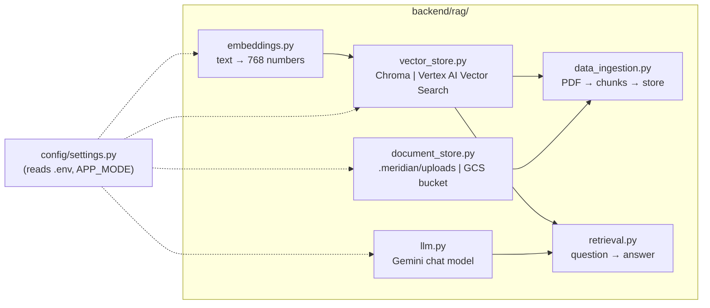
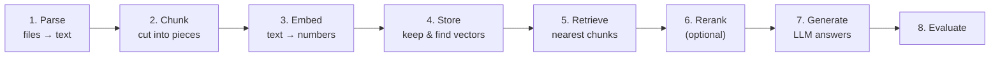
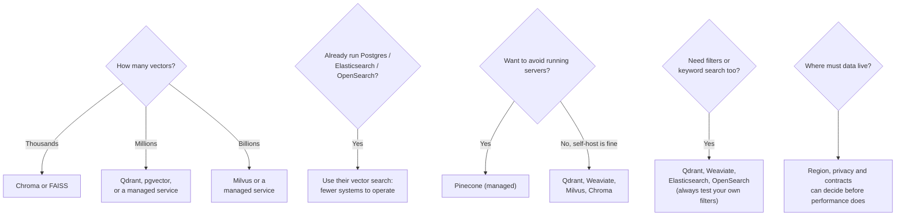
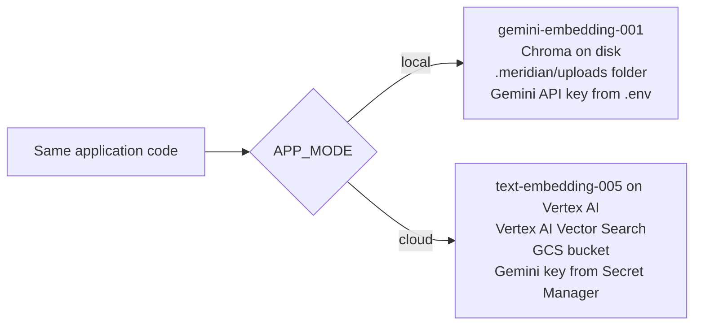
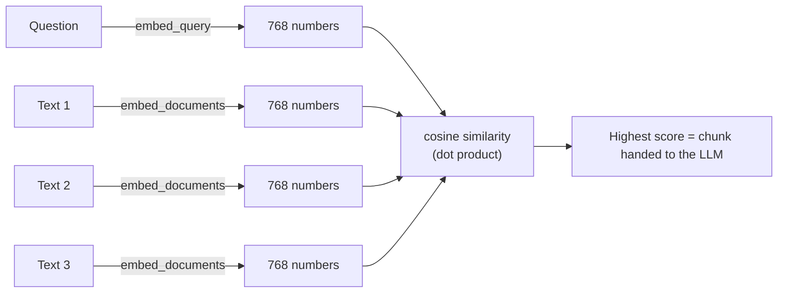
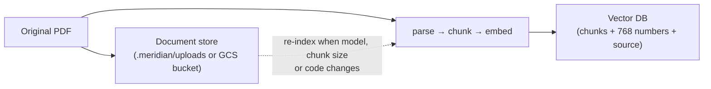
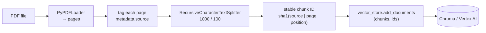
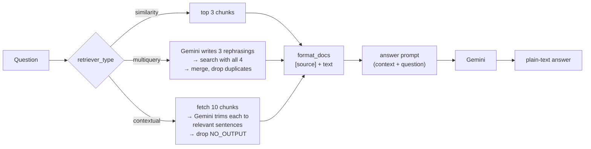

# 🧠 Meridian AI — Building the RAG Backend, File by File
### 📋 Agentic AI 3.0 Specialization | Krish Naik Academy

**🎙️ Mentor:** Mayank Aggarwal
**⏱️ Duration:** ~3.5 hours (recording) | **📅 Session:** Saturday, 17 October 2026
**🧩 Project:** Meridian AI (Module 4 of the project deck: *Document Q&A / RAG*)

---

## References
- https://meridian-ai-course.netlify.app
- https://github.com/mayank953/meridian-ai-learner
---

## 📰 Quick Updates

- **Slides and code:** the Meridian presentation is a Netlify site (`meridian-ai-course.netlify.app`). Mayank taught from the same deck, and it ends with a lab module. The code lives in a separate learner repo, `mayank953/meridian-ai-learner`, which he had pulled into a `meridian-reference` folder beside his working project.
- **Plan for the weekend:** today is about understanding the code well enough to run the RAG part locally. Tomorrow the project moves to the **audit team and service-centre screen**, and then to the cloud. Everyone should create a **GCP account** before the cloud part starts.
- **A placement story:** a fresher who had worked with Mayank on a real client project shared how he cracked his first role. The interview had only two basic DSA questions, and the rest was a 20–30 minute deep dive into a project he had actually built. His earlier interview had failed because his projects were copied or vibe-coded and he couldn't explain them. Mayank's takeaway: **one project understood in depth beats five to seven on a CV.** This is why he is going so deep on Meridian.
- **Upcoming course:** an **AI System Design** course (co-taught by Mayank) is planned, expected to launch around January. It focuses on scaling and deploying what everyone can now build with AI tools.

---

## 🗺️ Where Today Fits

The session did not teach RAG theory again (that was covered earlier, with a very long slide deck). It tied that theory to **the actual `backend/rag/` package** of Meridian, one file at a time, running each piece in a throwaway test script before moving on.



Mayank's reason for working module by module: *"We never develop the project completely in one go."* An AI engineer is asked about exactly these backend pieces in interviews, so each module was built, tested and understood before the next one was added. Ready-made code from Claude or ChatGPT is fine, but he argued that unless you test each function step by step, you won't be able to explain it.

---

## 🧰 The RAG Toolbox: Eight Steps, One Choice Each

A vector-RAG system breaks into eight steps. Each step has several tool options, and the deck compares them so the choice becomes a design decision rather than a default.



| Step | Example options mentioned | What Meridian uses |
|---|---|---|
| Parse | Unstructured, LlamaParse, Google Document AI, Docling | `PyPDFLoader` (any PDF reader works; PyMuPDF is equally fine) |
| Chunk | Fixed character, recursive character | `RecursiveCharacterTextSplitter`, size 1000, overlap 100 |
| Embed | Gemini, Vertex AI, OpenAI embeddings | `gemini-embedding-001` (local), `text-embedding-005` (cloud) |
| Store | Pinecone, Chroma, FAISS, pgvector, Qdrant, Weaviate, Milvus | Chroma (local), Vertex AI Vector Search (cloud) |
| Rerank | Cohere Rerank, cross-encoders | Not used in the project |
| Generate | Gemini, OpenAI, Anthropic | Gemini via `ChatGoogleGenerativeAI` |
| Evaluate | RAGAS, DeepEval, TruLens, LangSmith, or your own question list | Not covered in this project (done by hand in a lab) |
| Framework | LangChain, LlamaIndex, Haystack, DSPy, or none | LangChain |

Two side-notes from this slide:

- **Vector RAG is not the only RAG.** Mayank demonstrated **Docling** (IBM, open source), which converts an unstructured document into a structured one: it reads pages the way a person would, splits out tables, pictures and formulas, keeps provenance between pieces, and then **queries without vectors**. This is "vectorless RAG". It is heavier to run locally, but good at tables.
- **Serverless vs vectorless are different things.** *Vectorless* means no embeddings at all (Docling-style). *Serverless* is an infrastructure idea, like AWS Lambda: you hit the service on demand and pay per use, as opposed to running a server all the time. A *serverless vector DB* is just a vector database sold that way.

---

## 🔢 Choosing an Embedding Model

Mayank framed this as the short list of things to check, since they are favourite early interview questions:

| Check | Why it matters |
|---|---|
| **Number of dimensions** (e.g. 768, 1024) | More numbers capture more meaning, but cost more space and time in the database |
| **Languages** | English is almost always supported; other languages and other data types are a separate question |
| **Input limit** | A 10,000-character chunk needs a model that accepts that much text |
| **Hosted vs open weights** | Hosted API: send data, get vectors, pay per use. Open weights: run it yourself |
| **Same model for index and search** | The stored chunks and the incoming question must be embedded by the **same** model, or the numbers are not comparable |

In Meridian the model follows `APP_MODE`: Gemini embedding 001 locally and Vertex AI `text-embedding-005` in the cloud. Mayank mentioned that the cloud one is slated for deprecation next April but is fine for the course.

---

## 🗄️ Choosing a Vector Database

The deck reduces the decision to five questions, and Mayank called it the most system-design-flavoured slide of the day, with the caveat that these are heuristics, not rules:



- **Exact vs approximate search:** for a few thousand chunks, comparing the question against every vector is fast enough. The choice only starts to matter at millions.
- **Data residency example:** if the data must stay in US data centres, only services supported there are candidates. With multiple regions you may even need different replication per region, for example three replicas where regulation is strict and one elsewhere.

**Frameworks:** LangChain gives the project `PyPDFLoader`, the recursive splitter, a common `VectorStore` interface over Chroma and Vertex AI Vector Search, the Gemini chat wrapper, prompt templates, and the `|` pipe to join steps. LlamaIndex is strong when the whole job is indexing and querying documents, Haystack gives typed components that can be tested one at a time, and a small app can get by with just a provider SDK and a vector client. The slide's one-liner: **a framework saves plumbing, not the thinking part.** A common interface also makes it cheap to swap embedding 001 for 005, or Gemini for OpenAI or Anthropic.

---

## ☁️ Where Meridian Sits: Local vs Cloud

One environment variable, `APP_MODE`, switches the whole stack. Mayank compared it to dev vs prod environments: same code, different services behind it.



| Concern | Local | Cloud |
|---|---|---|
| Parser | PyPDFLoader | PyPDFLoader |
| Chunking | Recursive, 1000 / 100 | Recursive, 1000 / 100 |
| Embeddings | Gemini embedding 001 | Vertex AI text-embedding-005 |
| Vector store | Chroma (folder on disk) | Vertex AI Vector Search |
| Original PDFs | `.meridian/uploads/` | Cloud Storage bucket |
| Secrets | `.env` | Secret Manager (a `.env` file can't be shipped) |

Two clarifications Mayank repeated:

- **"Local" does not mean offline.** The Gemini embedding and chat calls still go over the internet with an API key. Local only means the cheaper, simpler setup.
- **Different stores, different scores.** Local and cloud use different embedding models and vector databases, so exact results can differ slightly. He judged the deviation small, and the cloud mode would be tested separately tomorrow. He used Chroma locally simply because Google's managed vector search can't run on a laptop.

---

## 🤖 `llm.py`: One Shared Brain

Both the RAG chain and the audit agents need a model, so there is **one** file that creates it. Mayank walked through two ideas here.

**1. Create it lazily and reuse it.** `@lru_cache(maxsize=1)` makes the first call build the `ChatGoogleGenerativeAI` object and every later call return the same one. When a student asked about LRU, he clarified this is **not a question-and-answer cache**; the cache stores the model *object*, which makes it a lazy singleton. The two benefits: the object is not rebuilt on every call, and it is not built at import time, so the API can start before anything is configured. He also said that if LRU confuses you, treat it as absent and move on.

**2. Normalise what Gemini returns.** Sometimes a reply is a plain string, and sometimes it is a list of content blocks. `extract_text` joins the text blocks so the rest of the code never has to care.

```python
@lru_cache(maxsize=1)
def get_llm() -> ChatGoogleGenerativeAI:
    """Create the chat model on first use (not at import time) and reuse it afterwards."""
    if not settings.GOOGLE_API_KEY:
        raise ConfigurationError("GOOGLE_API_KEY is empty. Add it to .env (https://aistudio.google.com/apikey).")
    return ChatGoogleGenerativeAI(
        model=settings.llm_model_name,
        google_api_key=settings.GOOGLE_API_KEY,
        temperature=settings.llm_temperature,
    )


def extract_text(content) -> str:
    """Gemini may return a list of content blocks, e.g. [{'type': 'text', 'text': '...'}]; join the text."""
    if isinstance(content, list):
        return "\n".join(
            block.get("text", "") for block in content
            if isinstance(block, dict) and block.get("type") == "text"
        )
    return content
```
*Source: `backend/rag/llm.py` in the learner repo.*

**Testing it, the way he does:** from the backend folder he ran a one-off script with `uv run python` that imports `get_llm` and `extract_text`, asks the model to reply with exactly "hello", and prints both the raw content type (a list) and the extracted text. Then he broke the key on purpose to show that the call fails, which is the "empty key raises a clear error" behaviour. His point was that this habit of checking each function in isolation is what builds real understanding of the project.

---

## 📐 `embeddings.py` and the Similarity Demo

The rule at the top of the file is the one from the toolbox: **the same model must be used for indexing and for querying**, so the model follows `APP_MODE`. Both modes produce **768-dimension** vectors. In cloud mode, that number is fixed by the Vector Search index, which the GitHub Actions deploy step creates.

```python
@lru_cache(maxsize=1)
def get_embeddings() -> GoogleGenerativeAIEmbeddings:
    if settings.is_cloud:
        if not settings.GCP_PROJECT:
            raise ConfigurationError("APP_MODE=cloud needs GCP_PROJECT_ID for Vertex AI embeddings.")
        return GoogleGenerativeAIEmbeddings(
            model=settings.embedding_model_name,
            vertexai=True,
            project=settings.GCP_PROJECT,
            location=settings.GCP_REGION,
            output_dimensionality=settings.embedding_dimensions,
        )

    if not settings.GOOGLE_API_KEY:
        raise ConfigurationError("APP_MODE=local needs GOOGLE_API_KEY in .env for embeddings.")
    return GoogleGenerativeAIEmbeddings(
        model=settings.local_embedding_model_name,
        google_api_key=settings.GOOGLE_API_KEY,
        output_dimensionality=settings.embedding_dimensions,
    )
```
*Source: `backend/rag/embeddings.py`.*

Two notes on this file:

- **One class serves both modes.** The older `VertexAIEmbeddings` is deprecated in LangChain v1. `GoogleGenerativeAIEmbeddings` covers the Gemini API and, with `vertexai=True`, Vertex AI.
- **How settings are wired.** Mayank traced a value through the files: `embeddings.py` reads `settings.local_embedding_model_name`; `settings.py` declares it with a default (`gemini-embedding-001`) and says "if the environment has it, take it from `.env`". The embedding dimension (768) is set in `settings.py`, not in `.env`. In short, `.env` feeds `settings.py`, and the rest of the code only talks to `settings`.

### Seeing similarity happen

To make "meaning as numbers" concrete, Mayank wrote a short script that embeds **one question and three short texts** with the real Gemini model, prints the first four numbers of each vector, and scores each text against the question.



- A person reads the question and instantly sees which text is closest. The code gets there by comparing vectors of the same length, produced by the same model.
- The best match scored about **0.85**. When he **added a second, related sentence** (about servo motors being paid on filling-line equipment terms), the matching score rose from **0.55 to 0.71**. Removing it dropped the score back to 0.55. The model reacts to meaning, not to exact words.
- **Read scores relatively.** Unrelated texts did not score near zero; they landed around 0.55 and 0.57. Real scores sit in a narrow band, so compare candidates against each other, never against 0. The score is also not an accuracy number.
- **Cosine vs dot product vs Euclidean:** any distance measure works. Meridian's cloud index uses dot-product distance, a close relative of cosine similarity. The repo ships a tiny three-number version of this idea in `docs/examples/05_similarity_demo.py`.
- **Images:** an image can be embedded the same way, provided the embedding model supports that data type.

---

## 💾 Why Keep the Original Files?

Before showing the storage code, Mayank asked the class: *once you've created the embeddings, can you delete the original PDFs?* Roughly 70–80% said yes.

The answer is **no**, and the reason is a follow-up: tomorrow a better embedding model arrives (or you change the chunk size, or fix a bug). How do you re-create the embeddings if the files are gone? You can't embed embeddings. The vector database holds **chunks and numbers, not your PDF**. So the design keeps two things:



---

## 🧱 `vector_store.py`: One Interface, Two Databases

```python
@lru_cache(maxsize=1)
def get_vector_store() -> VectorStore:
    """Connect on first use, so the API can start (e.g. /api/health) before anything is configured."""
    return _cloud_store() if settings.is_cloud else _local_store()
```

- **Local:** `Chroma(collection_name=..., embedding_function=get_embeddings(), persist_directory=...)`. The embedding function is attached to the store, so the store itself knows how to turn text into vectors.
- **Cloud:** `VectorSearchVectorStore.from_components(...)` with project, region, index ID, endpoint ID, GCS bucket and `stream_update=True`. It first checks that all required cloud settings are present. Note the parameter is `embedding` (singular), a detail worth remembering.
- Both are LangChain `VectorStore` objects, so ingestion and retrieval call the same methods (`add_documents`, `similarity_search`, `as_retriever`) and never know which database they got. This is what lets the project run on a laptop for a demo and on Cloud Run for real.
- Chroma is imported *inside* the local function so cloud images don't need it.

**Live demo.** Mayank wrote a test script that gets the store, adds three short texts with his own IDs (`demo1`, `demo2`, `demo3`), runs `similarity_search("...servo motor suppliers...", k=2)` and prints the two closest, then deletes the three IDs and prints what remains (nothing).

- Running it created a **`.meridian/chroma`** folder containing `chroma.sqlite3` and an ID folder. He opened the SQLite file in a viewer to show the collections, segments and embeddings tables, then said you don't need to understand that internal layout, because the point is simply that a persistent database appeared on disk.
- Behind the scenes each text was converted into **768 numbers** before being stored, with an HTTP call to Gemini for the embeddings (batching helps, and the cost is small).
- **Own IDs matter:** he supplied IDs so that records can be found and removed later. Deleting at the end was for demonstration only and is *not* normal practice.

**A common confusion, cleared up in Q&A:** a student asked whether you could skip the database and just stuff the data into the prompt. Mayank's answer: with 10,000 questions you'd be re-embedding everything every time; you need a store so embeddings are computed once.

---

## 📂 `document_store.py`: Where the Originals Live

Two operations are all the app needs: `save(local_path, filename)` keeps a copy of an uploaded PDF, and `pdfs()` yields `(local_path, source_name)` for every stored PDF. Locally that means copying into `.meridian/uploads/`; in the cloud it means uploading to a **Cloud Storage bucket** (Mayank described a bucket as "like a Google Drive", equivalent to S3 on AWS or Blob Storage on Azure).

The more interesting part is `pdfs()` as a **context manager**:

```python
@contextmanager
def pdfs() -> Iterator[Iterator[tuple[str, str]]]:
    """Yield (local_path, source) for every stored PDF.

    Used as a context manager because cloud files are downloaded to a temp folder
    that must be cleaned up afterwards.
    """
```

In cloud mode each file is **downloaded to a temp folder, handed over one at a time, and cleaned up afterwards**. Ingestion can therefore take hundreds of files one by one (embed, store, move on) without filling the disk. The source name is `local://<file>` or `gs://<bucket>/<path>`, so it identifies where a chunk came from in either mode.

Mayank's test script saved the sample procurement-policy PDF through `document_store.save` and printed the stored location; the file appeared in `.meridian/uploads`. The same code would fetch from the bucket in the cloud, and the extra functions exist because the same code runs there, "they will not be magically created on the cloud".

---

## ✂️ Chunking: Why Cut the Document at All

Mayank gave three reasons, using a whole book (the first Harry Potter, well over a million tokens) as the example:

1. **Too big to send.** A whole document won't fit in a prompt, and cost grows with length.
2. **Too blurry to search.** One 768-number vector for a whole page "describes everything and nothing".
3. **A sentence is the answer.** A small chunk matches a question precisely.

Meridian splits with `RecursiveCharacterTextSplitter` at **1000 characters with 100 characters of overlap**. Recursive splitting tries paragraph, then sentence, then word boundaries, so it respects structure better than fixed-size cutting. The overlap repeats the end of one chunk at the start of the next, so an idea sitting on a boundary isn't lost.

To show it, he re-ran a chunking demo on a policy document with **size 200 and overlap 40**. The result was three chunks of 199, 192 and 171 characters, with visibly shared text between neighbours. The repo's `docs/examples/03_chunking_demo.py` does the same, and changing `CHUNK_SIZE`/`CHUNK_OVERLAP` and re-running is the best way to feel it. (Each of the four sample PDFs is one short page, so in the project each becomes exactly one chunk; the chunking logic matters once you use longer documents.)

**How to choose a chunk size?** There is no formula. It is found by experimentation, typically starting at 1000–1500 characters and checking answer quality. Asking Claude or ChatGPT about your project and data is a sensible way to pick the first strategy.

---

## 📥 `data_ingestion.py`: PDF → Chunks → Vector Store



```python
def _chunk_id(chunk: Document, position: int) -> str:
    """Stable ID per chunk: re-indexing the same file overwrites instead of duplicating."""
    key = f"{chunk.metadata.get('source')}|{chunk.metadata.get('page')}|{position}"
    return hashlib.sha1(key.encode()).hexdigest()


def ingest_pdf(local_path: str, source: str) -> dict:
    try:
        pages = PyPDFLoader(local_path).load()
    except Exception as exc:  # pypdf raises many different error types
        raise IngestionError(f"Could not read PDF '{source}': {exc}") from exc

    for page in pages:
        page.metadata["source"] = source

    chunks = split_into_chunks(pages)
    if chunks:
        ids = [_chunk_id(c, i) for i, c in enumerate(chunks)]
        get_vector_store().add_documents(chunks, ids=ids)
    return {"pages": len(pages), "chunks": len(chunks)}
```
*Abridged from `backend/rag/data_ingestion.py` (logging omitted).*

Key points from the walkthrough:

- **Two entry points share one set of steps.** `ingest_pdf` handles a single file (the upload endpoint will use it) and `ingest_stored_pdfs` loops over everything in the document store.
- **Source is remembered.** Each page gets `metadata["source"]`, and every chunk inherits it. This is what lets an answer cite its file and what lets you find chunks again later for updates.
- **A bad PDF becomes a clear `IngestionError`**, not a raw library exception.
- **Idempotent by design.** Mayank ran ingestion on the same PDF twice and the store still held **one** chunk. Each chunk's ID is a SHA-1 hash, so the same chunk always gets the same ID, and the vector store sees an ID it already has instead of creating a duplicate. Adding a new file therefore never inflates the database with copies of old ones, which matters because a knowledge base keeps growing. When he changed the hash to something random, the count went to two, which proved the point.
- Running `ingest_stored_pdfs` on the four sample PDFs reported **4 files, 4 pages, 4 chunks**.

> 📝 **A precision note on the IDs.** In the live explanation the ID was described as depending on the chunk's *content*, so that "even a single character changes it". The code in the repo builds the hash from **source, page and chunk position** (which is also how the closing summary on the slide words it). That is what makes re-ingesting the same file overwrite rather than duplicate. It also means an edited chunk keeps its slot and is overwritten, but if an edit shifts later chunk boundaries or removes whole chunks, stale ones can remain. Detecting and handling such changes was explicitly parked for a dedicated RAG project (see Q&A).

---

## 🔎 `retrieval.py`: From Question to Answer

The retrieval module returns the chunks closest in meaning and has Gemini answer **only from them**. There are three strategies behind one signature (*question in, documents out*), and the chain is written with LangChain's pipe operator (LCEL).



```python
def _similarity(question: str, k: int = 3) -> list[Document]:
    return get_vector_store().similarity_search(question, k=k)


def _multiquery(question: str) -> list[Document]:
    rewriter = get_llm().with_structured_output(AlternativeQuestions)
    rewrites = rewriter.invoke(f"Write 3 alternative phrasings of this question: {question}")
    queries = [question, *rewrites.questions]
    seen, merged = set(), []
    for query in queries:
        for doc in _similarity(query):
            if doc.page_content not in seen:  # drop duplicates found by several queries
                seen.add(doc.page_content)
                merged.append(doc)
    return merged


def build_rag_chain(retriever_type: str = "similarity"):
    return (
        {"context": build_retriever(retriever_type) | format_docs, "input": RunnablePassthrough()}
        | ANSWER_PROMPT
        | get_llm()
        | StrOutputParser()
    )
```
*Abridged from `backend/rag/retrieval.py` (the `_contextual` function and prompts are in the repo).*

**The prompts**, which Mayank read aloud rather than dissecting: the system prompt tells the model to answer from the retrieved context, say "I don't know" if the context doesn't contain the answer, and stay concise. The extraction prompt used by the contextual strategy asks the model to copy, word for word, only the helpful sentences from the context, or reply exactly `NO_OUTPUT`.

**Why `multiquery` dedupes:** four rewritten questions will often retrieve the same chunk, and it should reach the model once, so results are merged through a "seen" set. This answered a student's direct question.

**Live comparison.** He ran one question ("What payment terms do servo motor suppliers get?") through all three strategies on the indexed sample files:

| Strategy | What happens | Model calls | Prompt content | Best for |
|---|---|---|---|---|
| **Similarity** | Embed question, take the nearest 3 chunks | 1 (the answer) | 3 full chunks | Clear questions; fast and cheap (the default) |
| **Multi-query** | Gemini rewrites the question 3 ways, search with 4 queries, merge | 2 | Up to 4 deduplicated chunks | Vague questions, or documents that use different words |
| **Contextual** | Retrieve 10 chunks, Gemini trims each to the relevant sentences | Many (one trim per chunk, plus the answer) | One short trimmed chunk (about 190 characters in this run) | Long, noisy chunks, such as 2,000-character chunks you want to reduce |

- Speed ordering in his run: **similarity fastest, then multi-query, then contextual**, matching the extra LLM work each performs. Timings will differ on every machine.
- On a corpus this tiny the differences in answer quality are small, so in practice the choice comes down to the question type plus cost and latency. The log line about "AFC" with a remote-call limit is Gemini's automatic function-calling machinery in the Google SDK and is harmless here.
- The log output also shows the three source documents returned for similarity: the procurement policy, a tariff schedule and the annual report.
- To understand a block of output like this, he pasted the whole log into ChatGPT and asked for an explanation by retriever type, which he recommends as a study habit.

---

## 🧪 Labs: Check It Yourself

The last two modules of the deck are practice, to be done by each student rather than demonstrated.

1. **Question lab (5 questions, 5 expected answers).** Run the five questions against your own ingestion and compare. Mayank's reasoning: before reaching for evaluation frameworks, **check the answers yourself**, because the person who understands the code best is the best evaluator. If an answer is wrong, diagnose it by reading the logs:
   - a fact is wrong → check the chunk or data;
   - "I don't know" for something it should know → retrieval missed it (chunking, embedding or `k`);
   - an out-of-scope question (the football question) gets a real answer → the system prompt isn't constraining the model;
   - a 503 or API error → provider or key issue;
   - slow answers → network latency or extra model calls (multi-query/contextual).
2. **Variants lab (homework, not part of the project).** Extra retrieval ideas to try in a separate file such as `variantlab.py`, **without touching the project code**: MMR, hybrid search with rank fusion, query decomposition, rewriting, and model-as-judge re-ranking. They are not in Meridian, to keep it uncomplicated.
3. **Stretch exercise.** Create several long documents, drop the chunk size to about 200, and watch how the whole cycle behaves with no framework involved.

---

## 🗺️ What's Next

- **Tomorrow:** the **audit team** (risk, tax and control agents feeding a CFO memo) and the service-centre screen. Agents in LangChain will be run locally first.
- Then **FastAPI** (and how it connects to the React frontend at a high level; Mayank said he'll keep frontend coverage light), followed by Docker and the cloud deployment on GCP with **GitHub Actions CI/CD**, so code changes in the repo are picked up and deployed automatically.
- Explicitly deferred to **a separate, dedicated RAG project**: updating or deleting parts of the knowledge base, metadata filtering, semantic caching, evaluation tooling (RAGAS-style), and table handling with Docling.
- Kubernetes is planned for a later project, not this one. In later projects, Mayank expects students to read the slides and code on the fundamentals, with class time spent on new material.

---

## 💬 Live Q&A Highlights

| Question | Answer |
|---|---|
| Why do we need to create an index for RAG? | If you use vector RAG, yes. Once vectors exist you can't search them as plain numbers; they must sit in a store where distances can be computed efficiently. |
| *(Basavanna)* When does indexing happen: between embedding and chunk, or when storing? | When you hand the embeddings to the vector store, it **indexes them internally** (think graph-like structure) so lookup is fast. Finding the nearest ones happens later, at query time, when the question is embedded. |
| Why not just embed on the fly instead of using a database? | With thousands of questions you would re-embed the whole corpus every time. Embed once, store, and only embed the question at query time. |
| You delete the chunks at the end of your demo. Is that normal? | No. That was only to show IDs let you remove records later. Normally you don't delete. |
| What's the strategy for chunk size? | By experimentation; start around 1,000–1,500 characters and look at answer quality. An LLM can help pick a starting strategy. |
| Can chunks be different sizes for different documents? | Yes, as long as every embedding comes out at the same dimension. Recursive splitting already adapts to structure. |
| Can the 768 dimensions be increased? | Yes, but the vector store must support the larger size. |
| Can audio and video be inputs? | Yes. Audio can be converted to text first; for video (or images), the embedder must support that data type. |
| Multi-region data with different policies? | Follow each region's rules, for example storing data in India and the US separately, with replication levels set by local requirements. |
| Serverless vs serverful vector DB? | Serverless is pay-per-use on demand (like Lambda); serverful is a server running all the time. Not related to vectorless RAG. |
| If the Gemini embedding model is deprecated, does the existing vector DB break? | Stored vectors are unaffected, but queries must be embedded with the same model, so after retirement you'd re-index with a newer one. That is why originals are kept. |
| How do you find the latency of code, as asked in interviews? | Explain where the bottlenecks are: measure which step (retrieval, model call, parsing) takes the most time. P95/P99 latency was noted as out of scope. |
| Why different vector DBs locally and in the cloud? | Google's managed vector search can't run on a laptop, so Chroma is used locally. Cloud mode will be tested separately; deviation should be small. |
| Why is the project called Meridian AI? | No special reason; Mayank simply picked the name. |
| Will we evaluate how well the system works? | Not with a framework in this project; a hand-run lab covers it. Evaluation tools come in a future project. |
| Why `LRU cache` in `llm.py`? | It's a lazy singleton for the model object, not an answer cache. Optional; remove it if it confuses. |
| Does a changed line mean re-ingesting the whole document? | No. Find the chunk(s) holding that line, get the IDs, and update only those. This will be built in a later project. |
| If a document changes slightly, are other chunks overwritten? | A repeated ingest of unchanged content re-uses the same IDs and doesn't duplicate. (See the ID note above for what the code actually keys on.) |
| What about tables or images inside PDFs? | `PyPDFLoader` plus the text splitter handles text only; images aren't embedded. Tables can be extracted separately, for example with Docling. |
| Large changes across many documents? | Re-run the whole ingestion; it depends on the scale of change. |
| Can I use MCP resources instead of RAG? | A completely different thing; not a substitute. |
| Should embeddings use more than one strategy? | One is fine. |
| Why keep both `local_path` and `source` in ingestion? | The path is where the file is now; `source` is the stable name saved in the metadata so you know where a chunk came from. |
| *(Anil)* If a section of an HR policy is removed, how do you handle its chunk IDs? | Use metadata: find which PDF changed, then delete all chunks whose source is that PDF and re-ingest it. When pressed on whether manual deletion is best practice, he deferred the full answer to the dedicated RAG project. |
| *(Anil)* Moving from Chroma to a cloud database means code changes? | Yes, but only in the store factory, which is why it has a single switch. Chroma itself can be used in production depending on the problem; for Azure, you'd add an Azure branch the same way Vertex AI is added. |
| *(Swati)* Will FastAPI-to-frontend wiring be covered? | At a high level, not line by line. |
| *(Swati)* Kubernetes, debugging and testing in production? | Kubernetes in a later project. Meridian uses CI/CD, so every repo change redeploys. Testing and validation come in later projects. Auto-scaling arrives with the cloud deployment. |
| *(Swati)* What to learn for security-product clients using Gen AI? | Learn security fundamentals and infrastructure first; AI agents are just one part of that picture. |
| *(Ramakrishna)* Where is the lab and what are the three variants shown last? | In Module 4's final lab pages of the deck. The variants (MMR, hybrid, and so on) are separate from the project's three strategies. |
| *(Karthikeyan)* Any reason for PyPDF over PyMuPDF? | No particular reason; either is fine. |
| *(Karthikeyan)* How do you cache repeated chatbot questions? | Embed the new query and compare it with cached queries. If similarity is above about 90%, reuse the cached answer. It depends on the domain (not for sensitive ones like medical). To be covered in the RAG project. |
| *(Karthikeyan)* How do you handle tables in PDFs? | Extract them first, or use Docling. Merging them back in order is a separate job and depends on your data. |
| *(Karthikeyan)* When is multi-query worth it? | For vague questions or documents that use different wording; the deck's strategy guide covers it. |
| *(Gopikrishnan)* What does `lru_cache` really do here? | It acts as a lazy singleton: the body runs once on first call, later calls return the same object, and nothing is built at import time. |
| *(Basavanna)* How do you evaluate retrieval apart from manual checks? | RAGAS-style frameworks exist; they will be covered in a future project. |
| *(Basavanna)* Is a vector DB only for files? Can I embed rows from a database? | A vector DB stores embeddings of anything you can chunk. Include the source (and any file/table info) in the ID/metadata. This is different from text-to-SQL, where the LLM turns a request into a SQL query. |
| *(Muthu)* Disputes checked against 30–40-page policy documents: RAG or upload to ChatGPT/Codex each time? | RAG is the better pattern for large policy documents. For an internal team, a project/custom GPT with the policies in its knowledge base is also reasonable. |
| *(Muthu)* Will agents run in a sandbox? | Deployment to dev and prod will be shown, including running agents in Docker containers. |
| *(Vipin)* What is the AI System Design course? | Focused on scaling and deploying systems built with AI, planned for around January; Mayank also plans YouTube content and will cover real examples inside projects. |
| *(Basavanna)* Will new courses be included in the annual subscription? | New courses become visible once they start. |

---

## 🔑 Key Pointers to Remember

- RAG has **eight steps**: parse, chunk, embed, store, retrieve, rerank (optional), generate, evaluate.
- Vector RAG is one kind of RAG; **vectorless RAG** (Docling-style) exists, and **serverless ≠ vectorless**.
- **Same embedding model for indexing and querying**, or the numbers aren't comparable.
- More dimensions capture more meaning but cost space and time (Meridian: **768**).
- Vector DB choice depends on scale (thousands → Chroma/FAISS; millions → Qdrant/pgvector/managed; billions → Milvus/managed), existing infrastructure, filters, and where data must live.
- A framework **saves plumbing, not thinking**; a common interface lets you swap models and stores with a setting.
- `APP_MODE` flips Meridian between **local** (Gemini API, Chroma, folder) and **cloud** (Vertex AI, Vector Search, GCS). Local still calls the internet.
- `@lru_cache` in `llm.py` and `embeddings.py` is a **lazy singleton**, not a Q&A cache.
- `extract_text` exists because Gemini can reply with a **list of content blocks**.
- Similarity scores are **relative**: unrelated text still scores ~0.55, so compare candidates, not against zero.
- **Keep the original files**: the vector DB holds chunks and numbers, and you'll need the PDFs to re-index with a new model or chunk size.
- Chunk with **recursive splitting, 1000/100**; the overlap protects ideas on boundaries.
- **Stable IDs make ingestion idempotent**: re-running the same file overwrites instead of duplicating.
- Retrieval strategies: **similarity** (fast, default), **multi-query** (rewrites + dedupe), **contextual** (trim chunks with the LLM). Pick by question type, cost and latency.
- Evaluate by hand first: if an answer is wrong, read the logs and decide whether data, chunking, embedding, retrieval or prompt is at fault.
- Build and test **one module at a time**; being able to explain your project in depth is what gets interviews cleared.

---

## ✅ Action Items After This Session

- [ ] Create a **GCP account** before the cloud sessions.
- [ ] Open the Meridian deck and revise Module 4 (RAG) and the final lab pages.
- [ ] Pull the learner repo and read `backend/rag/` (`llm.py`, `embeddings.py`, `vector_store.py`, `document_store.py`, `data_ingestion.py`, `retrieval.py`).
- [ ] Re-create the small test scripts yourself: get the LLM, embed and score three texts, add/search/delete in Chroma, save a PDF, ingest the same PDF twice.
- [ ] Run `docs/examples/03_chunking_demo.py` and `05_similarity_demo.py`; vary chunk size and overlap.
- [ ] Ingest the four sample PDFs and compare all three retrieval strategies on one question.
- [ ] Do the **5-question lab** and diagnose any wrong answers from the logs.
- [ ] Attempt the **variants lab** (MMR, hybrid search, decomposition) in a separate file without changing project code.
- [ ] Try your own long documents with a smaller chunk size.

---

*📝 Notes compiled from the full 17 October 2026 session transcript, the `mayank953/meridian-ai-learner` repository (code for `llm.py`, `embeddings.py`, `vector_store.py`, `document_store.py`, `data_ingestion.py`, `retrieval.py` and the `docs/examples` demos), "Meridian AI — Building the RAG Backend, File by File," Agentic AI 3.0 Specialization, Krish Naik Academy.*
