# 🤖 Meridian AI — Agents, Middleware & FastAPI: From Building Blocks to a Running Service
### 📋 Agentic AI 3.0 Specialization | Krish Naik Academy

**🎙️ Mentor:** Mayank Aggarwal
**⏱️ Duration:** ~4 hours 45 minutes (recording) | **📅 Session:** Sunday, 18 October 2026
**🧩 Project:** Meridian AI (the agent / audit-team module, then the first half of "run it locally")

---
## References
- https://meridian-ai-course.netlify.app/module-5#6
- https://github.com/mayank953/meridian-ai-learner
---

## 📰 Quick Updates

- **Homework from the RAG session:** the last two slides of the deck, the **RAG lab** and **"more RAG and code"**, are the most useful practice so far. Mayank asked everyone to run them, because seeing each RAG variant behave on your own machine is what makes them stick. He called these the best slides and code his team has produced.
- **Why one project, this deep:** this is the project meant for your CV. In his experience, **one project understood in depth beats four or five shallow ones**, because that depth is what lets you answer interview questions. Later projects will not get this much time; he will share code and explainers and expect you to read them.
- **Weekend plan:** the next session covers local running in full, then **Docker and Google Cloud**. He expects to finish the Meridian project, deployed on GCP, by the following weekend, and to hand out the **second project** (more advanced, covered more briefly) during the week.
- **Holiday:** the first weekend of November is off for Diwali (**7 and 8 November**).
- **Cloud certification:** he is not aware of a way to register for the cloud certification programme with a personal email ID.
- **Extra YouTube content:** DSA (in Hindi) and Python (in English) are on his channel for anyone who wants them.
- **Slide site glitch:** the Netlify banner blocked the "next" button on some slides during the FastAPI part. Zooming out or using the keyboard arrow worked in the meantime, and he planned to fix it.

---

## 🧭 Where Agents Fit in the Project

The audit team is the "intelligent" part of Meridian, but the session's point was to understand **where it sits** in the whole system, not to bolt on an agent for its own sake. Mayank's remark: many solutions say "we have an agent, so it's agentic" without anyone understanding the tools, prompts or middleware around it.

He opened with a quick LangChain refresher, using the vocabulary the course keeps returning to:

| Term | His (deliberately simple) definition |
|---|---|
| **Harness engineering** | Everything you build *around* the LLM to harness it: tools, prompts, guards. |
| **Loop engineering** | Letting the agent run in a loop until it has solved the problem. |
| **FDE (forward-deployed engineer)** | Someone placed at a client to understand their problem in depth, add the business side, and integrate AI. The role was popularised by Palantir. |

### The LangChain family, as used in this project

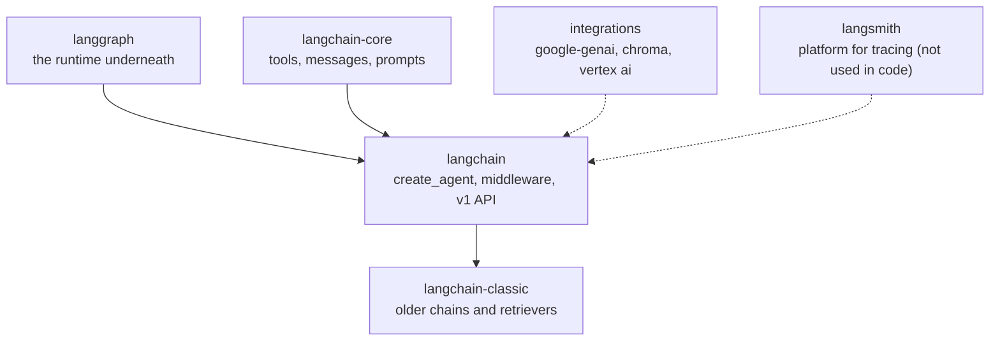

He noted that LangSmith appears in the family but is **not wired into the code**; anyone interested can integrate it as an extension. The code deliberately mixes the newer v1 style with a little legacy style, because real company code is rarely all-latest.

### A chain fixes the path; an agent chooses it

This was the line he asked everyone to remember.

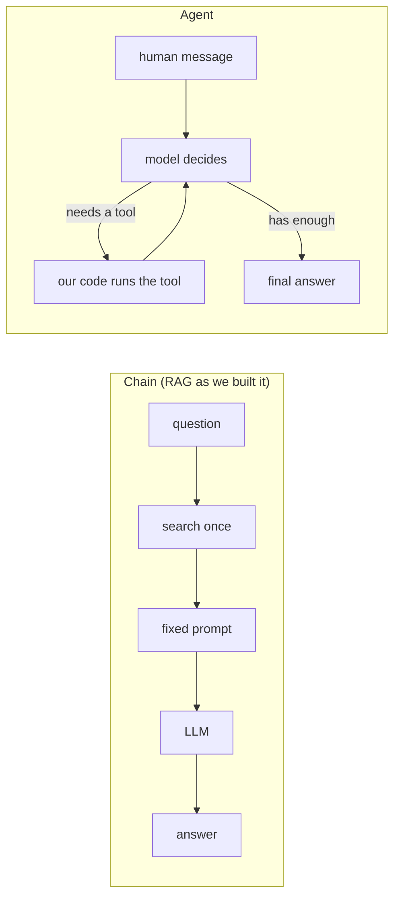

In a chain, the path is the same every time. In an agent the model can call a tool, look at the result, call another, repeat until satisfied, or answer straight away (a plain "hi" never touches a tool). When the tool is a retriever, the pattern is called **agentic RAG**, but tools can be anything. Mayank described the agent as "a digital human who takes the call on the go".

---

## 🧪 The Smallest Possible Agent (`try_agent.py`)

Before the project code, he built a tiny agent live: **one tool, one prompt, one question.** The tool, `approval_needed(amount_eur)`, returns which approver tier a purchase amount needs.

```python
# Shape of try_agent.py as typed in class (tool body and print formatting trimmed)
from langchain.agents import create_agent
from langchain_core.tools import tool
from rag.llm import extract_text, get_llm      # the shared Gemini helper from the RAG module

@tool
def approval_needed(amount_eur: float) -> str:
    """Return who must approve a purchase of this amount."""
    ...

agent = create_agent(
    model=get_llm(),                 # the brain
    tools=[approval_needed],         # the hands
    system_prompt="...",             # the role and rules
)

result = agent.invoke(
    {"messages": [{"role": "user", "content": "Who must approve a purchase of 480000 EUR?"}]}
)

for message in result["messages"]:
    calls = getattr(message, "tool_calls", None)   # only AI messages carry tool calls
    ...
```

The output showed the **message trail** that every agent run leaves:

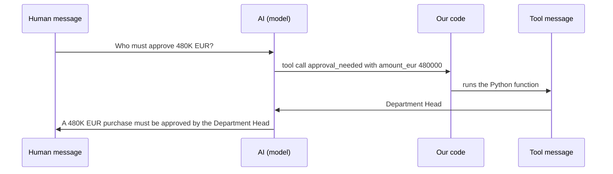

Four messages (Human → AI → Tool → AI) mean **the loop turned once**. The answer came from the function, not from the model's memory; the model only worded it. Mayank's key sentence: **a tool call is data**. The model emits a request (name plus arguments), and *your* code is what actually runs it.

> 💡 `get_llm()` is the function from `rag/llm.py`, a configured Gemini chat model (model name, API key, temperature). Everything in the project that calls an LLM goes through it. He also pointed to the LangChain quickstart as a good five-minute revision of the same pattern.

---

## 👥 Why a Team of Specialists

Instead of one agent with a pile of tools, Meridian uses **three narrow specialists and a CFO step**:

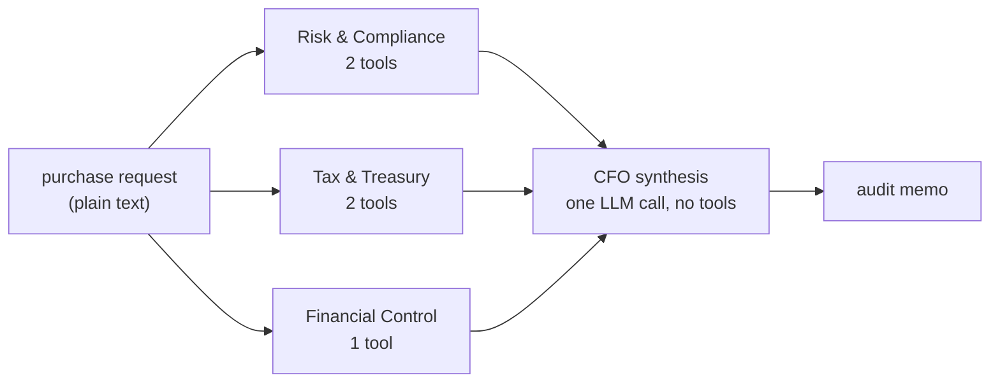

His reasons, in the same spirit as real teams:

- **Fewer tools, fewer mistakes.** With two tools or fewer, the model is far more likely to pick the right one than with ten.
- **Easy to test.** Each specialist can be run and judged alone.
- **Clear failures.** When something is wrong, you know which specialist to open.

The routing between specialists is ordinary Python (fixed order), while each specialist is genuinely agentic inside its own narrow job.

---

## 🔧 Tools: The Functions a Model Can Call

Mayank stressed that the tools decide what the agent can do at all: "if the right tools are not available, we also cannot function." The project's tools live in `backend/agent/tools.py`.

| Tool | Used by | What it does | Where the facts come from |
|---|---|---|---|
| `check_sanctions_list` | Risk | `RED ALERT` or `CLEARED` for a vendor name | Gemini's training knowledge |
| `get_vendor_credit_score` | Risk | Score 0–100 and risk level (unknown vendor → 45) | Gemini's training knowledge |
| `calculate_cross_border_tax` | Tax | VAT/GST, import duty, total cost for a route | Gemini's training knowledge |
| `validate_fx_hedge` | Tax | Compares the quoted FX rate with the market; 5% rule | **Live Frankfurter API**, Gemini only as a fallback |
| `categorize_expense` | Control | CapEx or OpEx, depreciation hint, sign-off flags | Gemini's training knowledge |

> 📌 **Naming note:** in the repo the FX tool is `validate_fx_hedge` and the expense tool is `categorize_expense` (singular). Both were spoken of slightly differently in class ("validate FX H", "categorize expenses").

### A tool, written twice

The slide he called "very, very important" shows the gap between what *you* write and what *the model sees*.

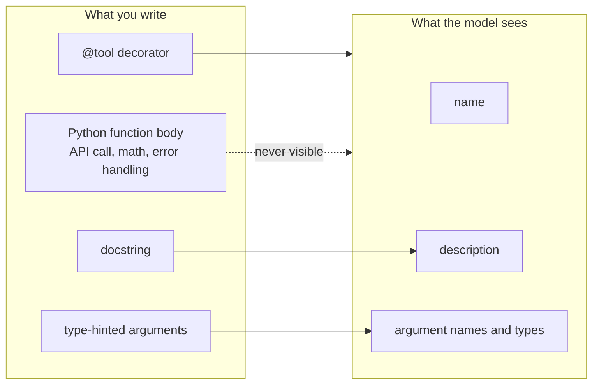

The model never sees the code. It sees only a **name, a description (your docstring) and the arguments**, and that is all it has to decide *whether* and *how* to call the tool. So the docstring is effectively part of the prompt, "written for the model". The repo ships a small demo that makes this visible without any API key:

```python
from langchain_core.tools import tool


@tool
def categorize_expense(amount: float, item_description: str) -> str:
    """Decide whether an expense is CapEx (a lasting asset) or OpEx (a running cost)."""
    return "CapEx" if amount > 5000 else "OpEx"


print("name       :", categorize_expense.name)
print("description:", categorize_expense.description)
print("arguments  :", categorize_expense.args)
print()

# You can call a tool yourself, exactly as an agent would:
print("call result:", categorize_expense.invoke({"amount": 480000, "item_description": "PLC controllers"}))
```
*(`docs/examples/04_tool_demo.py`)*

### The patterns inside the five tools

**1. One door to the model, errors become text.** Every LLM-backed tool goes through a tiny helper, and a failure is returned as text rather than raised, so one bad call never crashes the audit:

```python
def _ask_llm(prompt: str) -> str:
    """Invoke the configured LLM and return the text content."""
    try:
        response = get_llm().invoke(prompt)
        return extract_text(response.content)
    except Exception as e:
        return f"LLM_ERROR: {str(e)}"
```

The sanctions tool then turns `LLM_ERROR` into `SYSTEM WARNING: Sanctions check unavailable … Manual review required.` Mayank was candid that he kept this simple on purpose: a more elaborate version is possible, but the aim is to understand the blocks first, and Claude or Codex can add complexity on request.

**2. Ask for strict JSON, clean it, parse it, keep a fallback.** The credit and tax tools tell the model to answer with JSON only, strip any markdown code fence, call `json.loads`, and fall back to a safe value if parsing fails. He pointed out you *could* instead use structured output with Pydantic, which is the cleaner modern way, but wanted students to see what hand-rolled parsing looks like because real codebases contain it.

> ⚠️ **Worth knowing:** if the tax JSON cannot be parsed, the tool falls back to a flat **15%** rate and adds a note saying so. A fallback like that keeps the run alive but can quietly hide a failed parse, so read the logs.

**3. Keep exact rules out of the LLM.** The 5% FX threshold is computed in Python. His aside: some people now ask an LLM whether a number is even or odd. If something is fixed and deterministic, **don't ask the model**.

### The FX tool: real data first, model as a fallback

```python
# Attempt 1: live rate from the Frankfurter API
url = f"https://api.frankfurter.dev/v1/latest?base={base}&symbols={quote}"
resp = requests.get(url, timeout=10)
if resp.status_code == 200:
    data = resp.json()
    market_rate = data.get("rates", {}).get(quote)

# Attempt 2 (only if the API failed): ask the LLM for an approximate rate
...
    source = "LLM-estimated"

# The 5% rule is plain Python
variance = abs(rate_used - market_rate) / market_rate
if variance > 0.05:
    return (f"FX ALERT: Rate used ({rate_used}) vs {source} rate ({market_rate:.4f}) — "
            f"Variance {variance:.2%} EXCEEDS 5% limit. Audit required before payment release.")
return (f"FX SUCCESS: Rate used ({rate_used}) vs {source} rate ({market_rate:.4f}) — "
        f"Variance {variance:.2%} is within acceptable 5% hedge band.")
```

Frankfurter is a free, open-source exchange-rate API (it also has an MCP server on GitHub). `requests.get(..., timeout=10)` means "if no answer in ten seconds, give up and fall back". He used the moment to make a point about understanding the code: Claude will happily write this, but without understanding it you will not build the skill, will struggle in interviews, and will be stuck re-prompting "fix this" when it breaks.

**Live demo (`try_tools.py`):** the tool printed its name, description and arguments, then fetched a live **EUR→JPY** rate of about **177.82**:

- Quoted rate **179.6** → about 1% off → `FX SUCCESS`
- Quoted rate **190** → about 6.9% off → `FX ALERT`

He then changed the script to take any currency pair (EUR→INR, live rate about 106.9) and used the moment to show a sensible way to use an AI coding assistant: he selected the exact code, knew exactly what he wanted changed, and sent a one-line instruction ("add retry"/"make the currency an input"). His caution: if you don't know LangChain or coding at all, don't have an assistant build everything for you; it may work, but it won't scale.

### Which tools can you trust?

Only the FX tool uses real data. Everything else is **Gemini's memory**, meaning whatever it learned in training. There is no sanctions list, credit bureau or tax engine behind them. That is fine for a demo, and he said he had actually wired a real database in and then rolled it back to keep the project followable. The honest upgrade path is to connect real sources (a sanctions-screening service, a search tool such as Serper or Tavily, an internal database) and he asked everyone to try exactly that. He also mentioned that tools can be supplied through **MCP** (an MCP server is effectively "a collection of tools"), which he left out so as not to complicate the project.

### Memory vs tool: a demonstration worth remembering

He gave the FX tool to the small agent and asked "how much is 1 euro in INR?" The agent answered about **90.50**, from model memory; the tool was not called. Only after the prompt said *to use the `validate_fx_hedge` tool* did it call the API, and the result came back as `rate used 90.0 vs live market rate ~106, variance 15.78%`.

Two lessons: **a model with a tool still may not use it**, so clear instructions matter ("proper instruction has a role to play"); and Gemini's training-time exchange rate was months stale, which is exactly why a live-data tool exists.

---

## 📝 Prompts: Role, Responsibilities, Decision Framework, Output Format

Prompts live in one file, `backend/agent/prompts.py`, rather than inline in the tools. Splitting them into a `prompts/` folder (one file per agent) is also fine; the point is that prompts are easy to find, change and debug. Mayank's test for a good one: write it the way you would brief a new intern.

Every specialist prompt follows the same **four-part recipe**, which the file's header documents:

```text
1. ROLE               - who the agent is
2. RESPONSIBILITIES   - what it owns
3. DECISION FRAMEWORK - which tool to call, in what order, and how to read results
4. OUTPUT FORMAT      - an exact structure, so the next step can rely on it
```

For example, the Risk agent is told to run `check_sanctions_list` first ("a hard blocker; a RED ALERT means immediate rejection"), then `get_vendor_credit_score`, with thresholds:

```text
   - Score ≥ 75 → LOW RISK: Standard Net-30 or Net-45 payment terms acceptable
   - Score 50-74 → MODERATE RISK: Require 25–50% upfront deposit or a confirmed letter of credit.
   - Score < 50  → HIGH RISK: Escalate to Head of Global Procurement and CFO.
```

### Keywords are a contract

The CFO prompt does not read free text loosely; it searches the three reports for fixed strings:

| If a report contains… | Final decision |
|---|---|
| `RED ALERT` | **REJECTED** |
| `FX ALERT` or `HOLD FOR TREASURY AUDIT` | **CONDITIONAL HOLD** |
| every report shows `APPROVED` or `SUCCESS` | **APPROVED TO PAY** |

Those strings originate in the tools and the specialist prompts, so the file's comment says it plainly: **rename one, rename it everywhere.**

### Make the output structured, then apply logic on top

LLM output is always a bit fuzzy, and you can't build reliable logic on fuzzy text. If an agent returns a fixed field, say `SANCTIONS CHECK: CLEARED / RED ALERT`, code can branch on it. Compare "a status variable equals `APPROVED`" with trying to decide whether a paragraph "sounds approving".

Mayank was open that the project uses a **text output format inside the prompt** as a teaching choice, and that the better approach is a **Pydantic model passed as `response_format`** (LangChain accepts a Pydantic class, dataclass, `TypedDict` or JSON schema). Students were asked to do this conversion as an exercise; he even showed Claude being asked to extract the Pydantic models from the three output formats. Under the hood, the schema still reaches the model as instructions (or a provider's native structured-output mode where available), but the framework then **validates** the reply against the model, which is the part prompts alone can't give you.

---

## 🛡️ Middleware: Guards Around the Agent Loop

Middleware was introduced earlier in the course; here it is applied for real. Mayank called it one of the most important agent concepts and said that without it, people write 10× more complicated code by hand. "99% of people are not using it, so mentioning it in an interview sets you apart", and he added that interview-giving is itself a skill.

The idea (from the docstring in `middleware.py`): "airport security around the agent". Every request and every tool call passes through the checks, **in list order**, without touching the agent's prompt or tools.

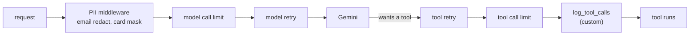

| Layer | Protects | What it does here |
|---|---|---|
| `PIIMiddleware("email", strategy="redact")` | **The customer** | Replaces e-mail addresses before the model sees the request |
| `PIIMiddleware("credit_card", strategy="mask")` | **The customer** | Masks card numbers before the model sees the request |
| `ModelCallLimitMiddleware` | **Your bill** | Ends a run after N model calls so an agent can't loop forever |
| `ToolCallLimitMiddleware` | **Your bill** | Caps tool calls per phase |
| `ModelRetryMiddleware` | **The audit** | Retries Gemini on transient errors with backoff |
| `ToolRetryMiddleware` | **The audit** | Retries flaky tools (e.g. the live FX API) |
| `log_tool_calls` (custom) | **Us, later** | One log line per tool call: name, args, duration, preview |

**Why PII must not reach the model:** personally identifiable information (e-mail, card number, passport, phone, social security number: anything that points at a real individual) shouldn't be sent to a model. Mayank's argument was that data you send to a hosted model might be used to improve future versions, and that leaks are expensive and regulated; one of his current client projects has to handle exactly this, including HIPAA. (Providers differ, so check the data-use terms of the plan or API you actually use.)

### The code

```python
@wrap_tool_call
def log_tool_calls(request, handler):
    """Custom middleware: time every tool call and write it to the audit log."""
    name = request.tool_call["name"]
    log.info("Tool call started", tool=name, args=request.tool_call.get("args"))
    started = time.perf_counter()
    try:
        result = handler(request)
    except Exception as exc:
        log.error("Tool call failed", tool=name, error=str(exc),
                  duration_ms=round((time.perf_counter() - started) * 1000))
        raise
    log.info("Tool call finished", tool=name,
             duration_ms=round((time.perf_counter() - started) * 1000),
             preview=str(getattr(result, "content", result))[:200])
    return result


def build_agent_middleware() -> list[AgentMiddleware]:
    """The middleware stack shared by all three specialist agents (order matters)."""
    return [
        PIIMiddleware("email", strategy="redact", apply_to_input=True),
        PIIMiddleware("credit_card", strategy="mask", apply_to_input=True),
        ModelCallLimitMiddleware(run_limit=settings.agent_max_model_calls, exit_behavior="end"),
        ToolCallLimitMiddleware(run_limit=settings.agent_max_tool_calls, exit_behavior="continue"),
        ModelRetryMiddleware(max_retries=settings.agent_max_retries, initial_delay=1.0),
        ToolRetryMiddleware(max_retries=settings.agent_max_retries, initial_delay=0.5),
        log_tool_calls,
    ]
```

The `@wrap_tool_call` decorator hands you the tool request and a `handler`: start the clock, call `handler(request)` to run the tool, log success or failure, return the result. Writing your own middleware has the same shape.

Two design points he emphasised:

- **Build it once, reuse it.** `build_agent_middleware()` returns the stack, and every agent just receives it. Change the stack in one place and all three agents change.
- **Settings, not constants.** The limits come from `config/settings.py` (`AGENT_MAX_MODEL_CALLS` = 8, `AGENT_MAX_TOOL_CALLS` = 6, `AGENT_MAX_RETRIES` = 2 by default), which reads `.env`. Following a value "from a simple `.env` file all the way down to the middleware" is exactly the habit he wants students to build.

### Live demo (`try_middleware.py`)

- **PII:** two agents received a message containing an e-mail address, with the instruction to reply with *only the e-mail address that appears in the message*. He printed the unprotected input side by side with the guarded agent's input: the plain one carried the full address, the guarded one carried it redacted, so the model never saw the real value.
- **Call limit:** an agent restricted to **one** model call reached the point where it needed the tool, then hit the limit and stopped with a "model call limit exceeded" message. This is what protects you from a looping agent and a surprise bill.

**Redact vs mask:** *redact* removes the value outright; *mask* hides most of it but leaves a trace. Mask when you still want a coarse signal (for example, which mail provider your customers use, or the last digits of a card); redact when you don't want any of it.

> 📌 **Logs:** tool-call lines go to the project's logger, which writes a file into a `logs/` folder under the directory you run from (and, in cloud mode, uploads it to the bucket on shutdown). For anything beyond a laptop, send them to a managed log service (see the Q&A on production logging).

---

## 🏗️ The Audit Team in Code (`agent/agents.py`)

With tools, prompts, the LLM and middleware ready, the team is assembled in very little code. This is where Mayank said the earlier slides "pay off": the later slides are easy because the blocks are already understood.

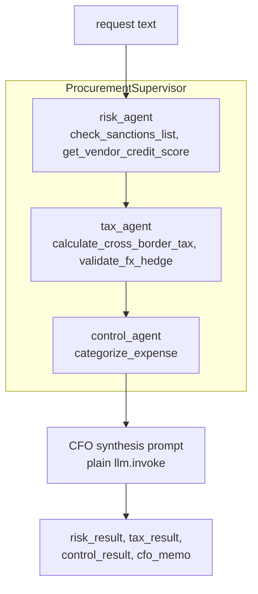

```python
def create_specialized_agent(tools, system_prompt):
    """An agent = the LLM + a set of tools + a system prompt (+ middleware around the loop)."""
    return create_agent(
        model=get_llm(),
        tools=tools,
        system_prompt=system_prompt,
        middleware=build_agent_middleware(),
    )


class ProcurementSupervisor:
    def __init__(self):
        self.llm = get_llm()
        self.risk_agent = create_specialized_agent(
            [check_sanctions_list, get_vendor_credit_score], RISK_AGENT_PROMPT
        )
        self.tax_agent = create_specialized_agent(
            [calculate_cross_border_tax, validate_fx_hedge], TAX_AGENT_PROMPT
        )
        self.control_agent = create_specialized_agent(
            [categorize_expense], CONTROL_AGENT_PROMPT
        )

    @staticmethod
    def _invoke_agent(agent, request: str) -> str:
        """Run one agent and return the text of its final message."""
        result = agent.invoke({"messages": [{"role": "user", "content": request}]})
        return result["messages"][-1].text  # .text joins Gemini's content blocks
```

`run_audit()` calls the three agents in order, builds the CFO prompt from their three reports, and makes one final tool-less LLM call:

```python
        risk_result = self._invoke_agent(self.risk_agent, request)
        tax_result = self._invoke_agent(self.tax_agent, request)
        control_result = self._invoke_agent(self.control_agent, request)

        synthesis_prompt = SYNTHESIS_PROMPT_TEMPLATE.format(
            risk_result=risk_result, tax_result=tax_result, control_result=control_result,
        )
        cfo_memo = self.llm.invoke(synthesis_prompt).text
        return {"risk_result": risk_result, "tax_result": tax_result,
                "control_result": control_result, "cfo_memo": cfo_memo}
```

**Design choices he called out**

- **Sequential on purpose.** Simple code and a readable log; the price is time. It can be made parallel (async, or LangChain's multi-agent patterns, which are in the docs under advanced usage), but a sequential run is far easier to follow in the logs.
- **One helper creates every agent**, so a change to middleware or invocation is made once. A `@staticmethod` is used for `_invoke_agent`; the `@staticmethod` / OOP details were deferred to his OOP video.
- **LangChain, not LangGraph.** `create_agent` runs on LangGraph underneath, but the project writes no graph code.
- **Every specialist receives the same request.** Each agent is built with its own prompt and tools, so each handles *its* slice of the same text. The supervisor does not "choose" an agent; it always runs all three.
- **Suggested extension:** build a separate agent and give it a "CFO memo" *skill*, as a way to practise skills versus prompts.

### The lab

Students are asked to do this themselves. Given a small purchase request (about 20 spare servo motors for roughly EUR 38,000 with a quoted FX rate), write a short script that creates a `ProcurementSupervisor`, calls `run_audit`, and prints the specialist reports and the CFO memo. Then run **three requests** to see all three verdicts: **approved**, **hold** and **rejected**. Read the logs, since they show every phase and every tool call. All names, dates and figures in the test data are invented.

---

## 🌐 From Agent to Service: Why FastAPI

After the agents, the session turned to the part Mayank said most AI learners skip, even though it is where AI becomes *usable*: "AI is never the full project; it becomes a part of it."

The problem: **a browser cannot call `run_audit()`**. All it can do is send an HTTP message. Something has to receive that message and turn it into a function call.

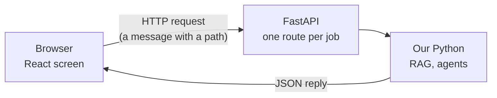

"The API is the front desk: it takes a request, calls the right function, and returns the answer."

### Request and reply: the basics

- `GET /hello` → an endpoint that replies `{"message": "hello"}` with status 200. Every production app has a **health check** like this so you can tell whether the service is up.
- `GET /hello/Asha?shout=true` → `Asha` is a **path parameter**, `shout=true` is a **query parameter** (GET parameters normally travel in the URL).
- `POST /orders` with a JSON body → data goes in the **body** (`Content-Type: application/json`).
- Missing field → **422** validation error. `quantity = -5` → "must be greater than 0". A rule of your own (item "forbidden") → `HTTPException` with **400**.

### Who does what when a request arrives

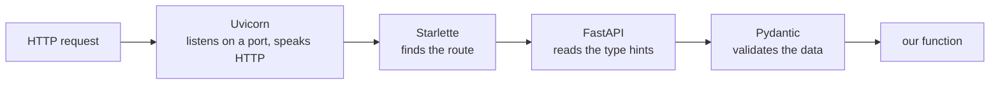

Five layers, and **we write only the last one**. Without these frameworks we would be building Uvicorn, Starlette and Pydantic ourselves.

| Piece | Role |
|---|---|
| **FastAPI** | Web framework: turns Python functions into routes, checks input, writes the docs |
| **Uvicorn** | The server process; listens on a port and hands each request to the app |
| **Starlette** | Small toolkit under FastAPI: routing, middleware, static files, test client (FastAPI builds on it) |
| **Pydantic** | Checks data against a class with typed fields |
| **Type hints** | Annotations like `name: str` that FastAPI reads to decide how to parse and validate |
| **OpenAPI** | A standard JSON description of an API's routes, inputs and outputs |
| **Swagger UI** | The interactive docs page FastAPI generates at `/docs` |
| **curl** | Command-line way to send a request, widely used in testing |

His advice: know these names, because naming Uvicorn, Starlette and Pydantic correctly in an interview tells the interviewer you didn't just ask an AI to write it.

### Live: a one-file FastAPI app (`try_hello.py`)

```python
from fastapi import FastAPI, HTTPException
from pydantic import BaseModel, Field

app = FastAPI(title="FastAPI hello")


class OrderRequest(BaseModel):
    """The shape of the data we expect. FastAPI checks every request against it."""
    item: str
    quantity: int = Field(gt=0, description="Must be greater than zero")


class OrderResponse(BaseModel):
    message: str
    total_items: int


@app.get("/hello")
def hello():
    return {"message": "hello"}


@app.get("/hello/{name}")
def hello_name(name: str, shout: bool = False):
    # {name} comes from the URL path; shout comes from ?shout=true in the query string
    text = f"hello {name}"
    return {"message": text.upper() if shout else text}


@app.post("/orders", response_model=OrderResponse)
def create_order(order: OrderRequest):
    if order.item.strip().lower() == "forbidden":
        # HTTPException turns into a proper HTTP error response
        raise HTTPException(status_code=400, detail="That item cannot be ordered")
    return OrderResponse(message=f"Ordered {order.quantity} x {order.item}", total_items=order.quantity)
```
*(`docs/examples/01_fastapi_hello.py`)*

In class the file first had no way to start the server (he caught the omission live and fixed it by running it with Uvicorn from the terminal, `uv run uvicorn try_hello:app --app-dir backend --port 8001`; `uv run` means "use this project's virtual environment with all its libraries"). Then:

- The root URL gave "not found" (no route there); `/hello` and `/hello/Mayank` replied as expected.
- `/docs` showed the auto-generated **Swagger page**, where he executed requests and watched the **browser dev-tools Network tab** show a real call reaching the backend. `/redoc` is an alternative docs view; the models (`OrderRequest`, `OrderResponse`) are listed too.
- A `curl` request did the same thing without a browser.
- Stopping the terminal stopped the server, and the URL stopped answering, "just like when a big site goes down".

His point: a real app is the same thing, with `run_audit` and `ask_question` imported and called from routes.

### How Meridian wires it up (from the repo)

These were glimpsed rather than walked through, since the next session covers running the full app, but they are the target of everything above:

```python
# api/schemas.py
class AuditRequest(BaseModel):
    request_text: str

class AuditResponse(BaseModel):
    risk_result: str
    tax_result: str
    control_result: str
    cfo_memo: str

# api/endpoints.py
@lru_cache(maxsize=1)
def get_supervisor() -> ProcurementSupervisor:
    """Build the agents on the first audit request, not when the server starts."""
    return ProcurementSupervisor()

@agent_router.post("/audit", response_model=AuditResponse)
def run_audit(payload: AuditRequest):
    """Run the full multi-agent procurement audit and return all phase results."""
    try:
        return AuditResponse(**get_supervisor().run_audit(payload.request_text))
    except MeridianError:
        raise  # handled in api/main.py
    except Exception as e:
        log.exception("Audit failed")
        raise HTTPException(status_code=500, detail=str(e))
```

The route is thin: validate the input, call the real logic, return JSON. The other routes are `/api/health`, `/api/status`, `/api/rag/ask`, `/api/rag/upload` and `/api/rag/ingest`. The upload route is the one that calls `ingest_pdf` when a file is dropped on the UI (see the Q&A).

---

## 🗣️ Serving Agents: Keep Them Stateless

Several questions circled one idea: *where does the agent live while a chat continues?* Mayank's answer, built across the Q&A:

- There is **no "LangChain server" running 24/7** in Meridian. When a request hits FastAPI, the route builds (or reuses) the agent, invokes it, and returns. The agent exists *for that call*.
- For a long chat, don't spawn one agent per conversation. The agent needs only **the model, the tools, and the previous messages**. So pass in the **user ID and message history** on each call, and any running instance can serve any user.

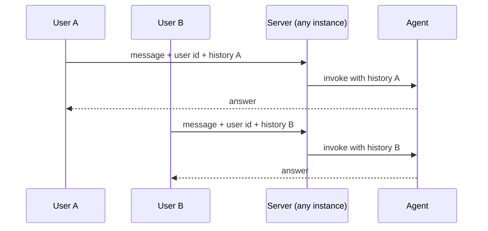

- For thousands of users you would still scale the **server**, not hand-craft agents. Hosted agent platforms (Agent Engine on GCP, Bedrock on AWS) and LangChain's own server options exist for this. The simplest self-managed variant he described is a loop with a timeout (for example, shut down after 60 idle minutes), but "stateless is much better".
- Don't run an agent continuously just because you can; it is rarely the best call.

---

## 🚀 What's Coming: Docker, GCP and CI/CD

A brief preview, with a stated philosophy: "I never get the confidence to run something on cloud unless I can run it locally first." The route is **local → Docker → GCP → CI/CD**.

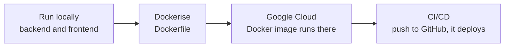

- **Docker:** the same app that runs locally is packaged and runs on GCP; the Dockerfile pulls libraries from `requirements.txt`. It is possible without Docker, but not recommended.
- **CI/CD:** the repo has a GitHub Actions workflow that builds the image, provisions what is needed and deploys on a push. **Infrastructure as code** (Terraform) provisions the buckets and other resources.
- **AWS or another cloud?** If it runs locally and in Docker, it can run anywhere. A few things (credentials, storage and vector backends) would change, and AI tools can help, but the project is built on GCP.
- **Cost:** GCP needs a billing account, and the free credits (a few months and a few hundred dollars were mentioned) are meant to be used on exactly this. But a deployed service left running can burn through credits within about a week, so **stop or delete resources after each session**.
- **Agent Engine vs Kubernetes:** Mayank said the project scales through Agent Engine rather than Kubernetes (which may come later).

> 📌 **Check against the repo:** the deployment files in the learner repo (`.github/workflows/deploy.yml`, `DEPLOY.md`, the Dockerfile) target **Cloud Run**, with the vector index on Vertex AI Vector Search. The spoken description of the target as "Agent Engine" may refer to what he plans to use for the agent part. Expect the exact deployment shape to become clear in the deployment sessions.

---

## 🗺️ What's Next

- **Next session:** running the whole app locally (frontend and backend together), logging and tests, then **Docker and Google Cloud basics**, with full deployment and **CI/CD** to follow. Everyone should have a working GCP account and have run the app locally first.
- **Second project:** shared during the week; more advanced, covered mainly on the new parts, with **caching** among the techniques. He will release the code and explainers and expects students to read them, so revise the basics first.
- **Later projects (as currently planned):** one on **LangChain**, one on **LangGraph**, and an in-depth **RAG** project. That RAG project is where scaling to thousands of documents, local/offline RAG and evaluation will be taken up. Evaluation frameworks, LangSmith and other monitoring are intended for the later projects.
- **Security design:** to be taught in a separate project towards the end of the course.
- **Loop engineering** (agents that run in a loop for long periods, with middleware and tools) will be covered in a separate recording he planned to share.
- **No class** on 7 and 8 November (Diwali).

---

## 💬 Live Q&A Highlights

| Question | Answer |
|---|---|
| Could the approval question be answered with a retriever instead of a tool? | Yes, and that's where the project goes next. The tool was only used to show the agent loop. For document knowledge, use RAG. |
| When use RAG instead of training (fine-tuning) a model? | Default to RAG wherever you can; fine-tuning costs far more time and effort. |
| Our company only permits Copilot, not Gemini, for RAG. Does that matter? | No, the pattern is the same; swap the model provider. |
| Is uploading a document to Claude the same as RAG? | In Projects, yes. In plain chat, it may use it as a tool or, for a small file, just include the whole document. |
| For documents, RAG or a tool? Which performs better? | RAG. The knowledge sits in documents, which a hand-written tool can't replace. |
| Is CI/CD part of the cloud module? Do we use Kubernetes to scale? | Yes, CI/CD with GitHub Actions and Docker. No Kubernetes in this project; Agent Engine scales automatically. Kubernetes may come later. |
| How do you handle thousands of documents? | Better vector store and retrieval design; that goes into the dedicated RAG project. |
| "The answer came from Gemini memory": what does that mean? | The model answered from what it learned in training, not from a live source. Gemini would give an out-of-date exchange rate, which is why the FX tool calls a real API. |
| So the sanctions tool isn't checking a real list? | Right: it asks Gemini from its training knowledge, with no list maintained by us. Add a search tool (Serper, Tavily, Google) or an internal database to make it real. He built a database version and removed it to keep the project followable. |
| Why not use "skills" instead of a prompts file? | They are different things. The prompt is the role and rules given to the agent when it is defined; a skill is a packaged way of doing a particular task. Agents can be equipped with skills too. |
| Can I keep part of the instructions inline and part in a prompt file? | Yes, but the agent won't reconcile them for you. Whatever you give it is what it gets, so you make sure it is consolidated. |
| Where can I read about token optimisation? | His Claude Code video covers it. |
| How is redacting different from masking? | Redact removes the value; mask hides most of it but keeps a trace (such as which mail provider, or the last card digits). Use mask when you still want that coarse signal. |
| How do we make sure the middleware is applied to every agent? | Pass it when the agent is created. The project builds the list once in `build_agent_middleware()` and hands it to each agent via one helper. |
| Can agent creation be made configurable instead of hard-coded? | It already goes through one function, so tools, prompt and middleware can all be parameters; make it as dynamic as you need. |
| We pass the same request to all three agents; does it pick the right one? | No selection happens. All three always run, each with its own prompt and tools, and each handles its own part of the request. |
| What risks does the compliance agent check? | Sanctions status and the vendor's credit score, and it returns a payment-terms recommendation. Read the prompts to see exactly how each agent behaves. |
| Is writing the output format in the prompt the right way? Can we use structured output? | Structured output (Pydantic) is better, and he showed it earlier in LangChain. For this project the prompt format was kept as a teaching choice. |
| How do I bring documents from SharePoint / shared storage into ingestion? | Fetch them first, then ingest. Use the storage SDK with authentication (`boto3` for S3; the Azure Storage Blob library for Azure Blob: list the container, download the files), either as a tool the agent calls or as a step at start-up. MCP only if your company allows authenticating it. LangChain also has a SharePoint loader. |
| Should I use LangSmith in production? | Yes, for tracing agents, alongside a clean project structure. It's planned in a later project. |
| Can I use a framework to build my own project structure? | Finish this project in depth first; the second project adds caching, and building projects is the best way to learn structure. |
| Why isn't Frankfurter listed in Swagger `/docs`? | Swagger documents *our* FastAPI routes only. Frankfurter is an external service with its own docs (Swagger isn't the only way to document an API). |
| Do I need a separate "LangChain server" next to FastAPI? | No. FastAPI receives the request, and the agent runs inside that call; nothing runs 24/7. |
| Isn't FastAPI the same as MCP, JSON-RPC aside? | They solve different problems. FastAPI is the backend that serves *our application* (React front end, endpoints). MCP exposes *tools* for other AI clients to use. Here the routes call plain functions directly. MCP servers are inspected with the MCP Inspector, not Swagger. |
| How much changes if I use OpenAI or Claude instead of Gemini? | Very little, because everything goes through `get_llm()`. Swap `ChatGoogleGenerativeAI` for `ChatOpenAI` or `ChatAnthropic` (or add a provider argument), and type the return as the common `BaseChatModel`. |
| Can I deploy without Docker / Docker Compose? | You can, but Docker is the recommended path, and we'll run it in Docker locally first. A Compose file is easy to add. |
| I know GitHub Actions but not GitLab CI. | Git is the core; GitHub and GitLab are implementations of it. AI now makes writing the pipeline templates for each environment quick. |
| Copilot or Claude for Angular / .NET? | He prefers Claude for coding generally, but results depend on how you use the tool. Claude Code comes as a VS Code extension, a terminal tool, and a desktop app, all under the same licence. Put your standing instructions in a `CLAUDE.md`; there is no fixed template, it depends on your team. |
| Can you upload the `try_*` example scripts? | He intended students to type them from the slides but agreed to upload them. |
| Can the instructors get students free access to top models? | He and Krish raised it at OpenAI DevDay: they won't give advanced models free, but credits are possible. Some companies give limited early access for testing. |
| Does the LLM also produce embeddings? How do I separate the calls? | No. Chat models and embedding models are separate; the project calls an embedding model for vectors and a chat model for answers. Tools like Copilot or ChatGPT may use an embedding model behind the scenes, but that isn't something a chat model gives you. *(Embedding APIs do exist and the project uses one; the point is that they are a different model.)* |
| Which CI tools do agentic apps need (e.g. SonarQube)? | CI/CD isn't AI-specific. First comes your normal tests. Then, depending on the project: evaluation frameworks (such as DeepEval), guardrails, quality scanners (SonarQube), then monitoring (AgentOps, LangSmith, cloud monitoring). Infrastructure is provisioned as code (Terraform). There is no single list. This project: custom tests plus CI checks, then GCP monitoring; evaluation comes in the next project. |
| Do we need to buy a domain for the GCP deployment? | No; GCP gives you a service URL. A custom domain is possible but not for this project. |
| Offline multimodal RAG: Docling extraction works but answers are poor. | Docling gives *structured* output (JSON/Markdown) and shines in **vector-less** RAG; it isn't meant to be the thing you embed wholesale. Chunk the content and retrieve only relevant chunks (vector, or vector-less matching); sending the whole Markdown to the LLM defeats RAG and confuses it. For offline, use a local embedding model and a local LLM; pick the current best libraries for text, images and tables (and ask an AI to search for them). This will be covered in his RAG-focused project. |
| How do I run a chat agent for many users? | Keep the agent stateless; pass user ID and message history per call; scale the server. See the section above. |
| How would you handle voice agents (inbound calls)? | His client project uses **Vapi**: the voice agent is hosted on Vapi, which calls his own backend (booking, RAG, dashboard) through tools, so there is no extra agent in the middle (extra agents add latency). Calendar lookups are cached because live queries are too slow on a call. |
| Is "transfer to a human" a fallback? | No; it's a requested feature offered to the caller. Leads follow a **14-day cadence** (call, SMS, voicemail, email) so a missed call is retried rather than dropped. He plans to share the lessons around January. |
| Gemini returns "model is experiencing high demand" even with a free GCP account. | Free-tier or default projects hit this. Create a proper project with a real billing account in AI Studio, create an API key against that project, and expect to add a small amount of money. |
| Will we cover LangSmith? | Yes, within a project. |
| Can the project be moved to AWS? | Yes, with changes: it runs on any cloud once dockerised. Local/cloud mode can be extended with a provider choice. |
| Should the multi-agent run be sequential, or streamed to the user step by step? | Both are possible. The better UX is an agent that breaks the task down and keeps the user informed while it works (what Claude does). Loop engineering and middleware make that robust; he promised a recording. |
| Voice-to-text (e.g. Whisper Flow): self-host or paid? | He recommends hosting a local Whisper model; OpenAI's Whisper models are strong, and multilingual (including Hindi) models exist. Whisper Flow is good marketing and a smooth experience, but as infrastructure a local model is cheaper. |
| Isn't continuous follow-up wasteful for agent calls? | It isn't continuous: it's a **cadence** with a daily check, and the agent only acts when the cadence says so. |
| How do I ingest new files from a drive automatically (dynamic chunking)? | Keep the same chunking strategy; trigger ingestion when a new file arrives (upload or a watcher), not on a timer that chunks nothing. In Meridian, the upload route calls the ingestion function. |
| Where are production logs stored? | In a managed log service (AWS CloudWatch, Google Cloud's logging service; both are paid), with local logs for debugging. Agent-level traces go to a tool like LangSmith. |
| Is a card required for GCP, and what does it cost? | Billing details are required. The free credits should cover this project, but running resources continuously can eat them in about a week, so shut things down. |
| How does semantic search find "car breakdown" for "car malfunction"? | The embedding model places similar meanings close together as vectors, so queries with different words but similar meaning land near each other. Dimensions matter, but so does how the model was trained. |
| How can I see what's stored in the vector database? | With Chroma on disk you can open its SQLite file. He re-ran the store script, opened it in a SQLite viewer and showed the **chunk text, IDs and metadata** per record. He wasn't sure of Chroma's internal layout, so he asked Claude to inspect it, which found the vectors via a join through the embedding tables. The point: it's an ordinary database. |
| Can I practise with a Google or local embedding model instead of OpenAI's? | Yes. Embedding models are comparatively fast and cheap, many can be downloaded and run locally, and the vector store doesn't care which one produced the vectors (as long as you use the same model for documents and questions). |
| Do we store whole documents? | No, **chunks** with their embeddings and metadata. All pages are chunked on upload. |
| Is the user's question stored? | Not by default. The question is embedded, compared to chunk vectors, and the nearest chunks go to the LLM. You can store it if you want. Length doesn't matter; multi-query RAG breaks long questions into parts. |
| Can we use Qdrant, Weaviate or other cloud vector databases? | Yes, but they charge for storage and queries, and the embedding model is billed separately. |
| Who inserts documents in a real system? | Depends on the product: customers or staff via an upload screen, an admin role (e.g. HR admin for a policy repository), or a developer-run pipeline. Meridian exposes an upload route; the UI calls it, and it runs the ingestion pipeline. |
| Can LangChain run agents in parallel, or a child agent from a parent? | Yes. An agent is just a function, so you can call several concurrently. Multi-agent hierarchies in LangChain are done by exposing agents *as tools*; revise that module. |
| Is an SDK the same as an API? | No. An API is an interface you call; an SDK is a software development kit you *use* to build with (LangChain is a Python SDK). Read up on the difference; the basics matter. |

---

## 🔑 Key Pointers to Remember

- **A chain fixes the path; an agent chooses it.** A tool call is *data*; your code runs it. A run leaves a message trail: Human → AI (tool call) → Tool → AI.
- **The model sees a tool's name, description and arguments, never its code.** Write docstrings for the model.
- **A model with a tool may still answer from memory.** Tell it to use the tool; verify with the trail or logs.
- **Only `validate_fx_hedge` uses live data** (Frankfurter); the other tools lean on Gemini's training knowledge. Real systems need real sources.
- **Don't ask the LLM for deterministic rules.** The 5% FX check is plain Python.
- **Tool errors become text, not crashes**, with a "manual review required" fallback; but read the logs, because fallbacks can hide failures (e.g. the flat 15% tax rate).
- **Prompt recipe: role, responsibilities, decision framework, output format.** Keep prompts in one file.
- **Keywords are a contract** (`RED ALERT`, `FX ALERT`, `HOLD FOR TREASURY AUDIT`): rename one, rename everywhere. Better still, return structured output (`response_format`) and branch on fields.
- **Narrow specialists beat one big agent:** fewer tools, easier tests, clearer failures.
- **Middleware order matters.** PII protects the customer; call limits protect your bill; retries protect the audit; logging protects your future debugging.
- **Redact removes; mask keeps a trace.**
- **Build the stack once** (`build_agent_middleware()`), reuse it for every agent, and drive limits from `.env` through settings.
- **The audit is sequential on purpose.** It can be parallel, and agents can be tools of other agents.
- **A browser can't call your Python.** FastAPI is the front desk: Uvicorn → Starlette → FastAPI → Pydantic → your function.
- **FastAPI ≠ MCP.** FastAPI serves your app; MCP exposes tools to other AI clients.
- **Keep agents stateless:** pass user ID and history per request and scale the server.
- **Vector DBs store chunks, vectors and metadata, not documents or questions.** Embedding models are separate from chat models.
- **Understand the code before you vibe-code it.** AI can write it, but only your understanding keeps it good and gets you through interviews.
- **Run it locally before you put it on the cloud**, and shut cloud resources down after each session.

---

## ✅ Action Items After This Session

- [ ] Do the **RAG lab** and **"more RAG and code"** slides if you haven't.
- [ ] Re-create `try_agent.py`: one tool, one prompt; print the message trail and confirm the loop ran once.
- [ ] Run `docs/examples/04_tool_demo.py` and read the name / description / arguments it prints.
- [ ] Test `validate_fx_hedge` directly with a quoted rate within 5% and one beyond it; then switch the currency pair.
- [ ] Give the FX tool to the small agent and compare the answer with and without telling it to use the tool.
- [ ] Read all three agent prompts and the CFO template in `prompts.py`.
- [ ] Convert one agent's output format to a **Pydantic model with `response_format`**.
- [ ] Re-create `try_middleware.py`: show PII redaction, then a one-model-call limit; try `AGENT_MAX_TOOL_CALLS=1` and see which report changes.
- [ ] Add a real source to one tool (a search tool or a small database) and watch the trail change.
- [ ] Do the **audit-team lab**: write `try_audit.py` and run an approved, a hold and a rejected request.
- [ ] Run `docs/examples/01_fastapi_hello.py` with Uvicorn; try `/hello`, `/docs`, a valid and an invalid `POST /orders`, and a `curl` call.
- [ ] Pull the learner repo and read `api/main.py`, `api/endpoints.py`, `api/schemas.py`.
- [ ] Revise MCP versus APIs/SDKs and the OOP basics (`@staticmethod`) if they are fuzzy.
- [ ] Make sure your **GCP account and billing** are set up, and that Gemini works on a proper project and key.

---

*📝 Notes compiled from the full 18 October 2026 session transcript and the `mayank953/meridian-ai-learner` repository (`backend/agent/tools.py`, `prompts.py`, `middleware.py`, `agents.py`, `backend/api/*`, `backend/config/settings.py`, and `docs/examples` demos), "Meridian AI — Agents, Middleware & FastAPI," Agentic AI 3.0 Specialization, Krish Naik Academy. The course slide site (`meridian-ai-course.netlify.app`) could not be retrieved, so slide content is taken from the recording and the repo.*
