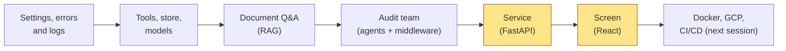
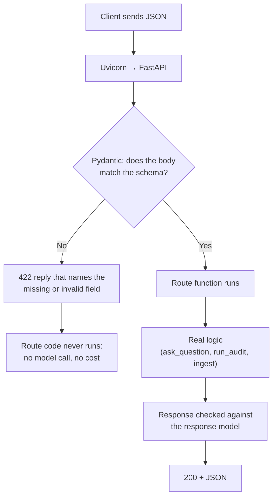
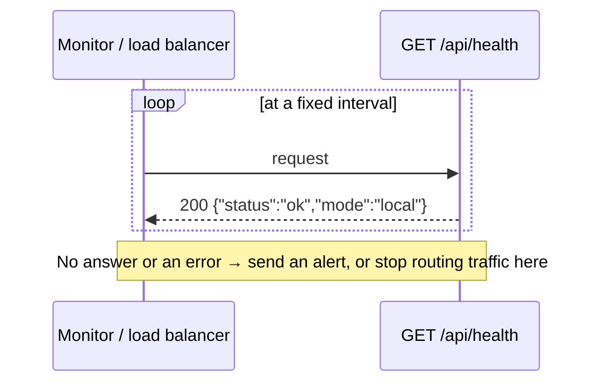
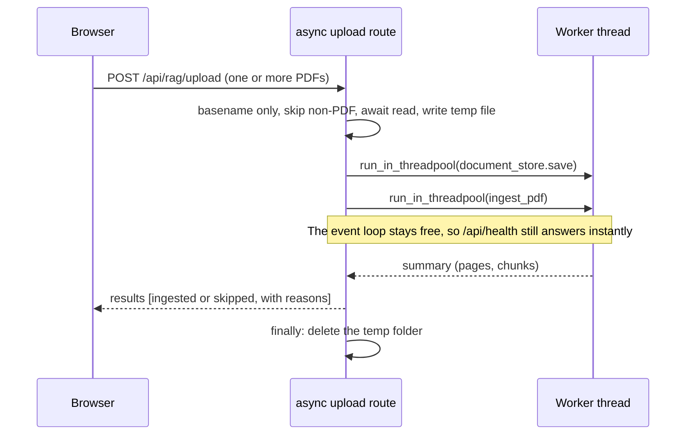
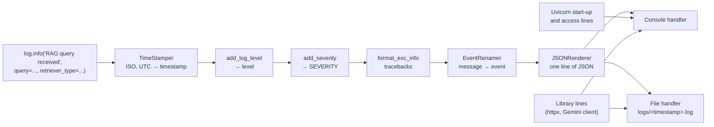
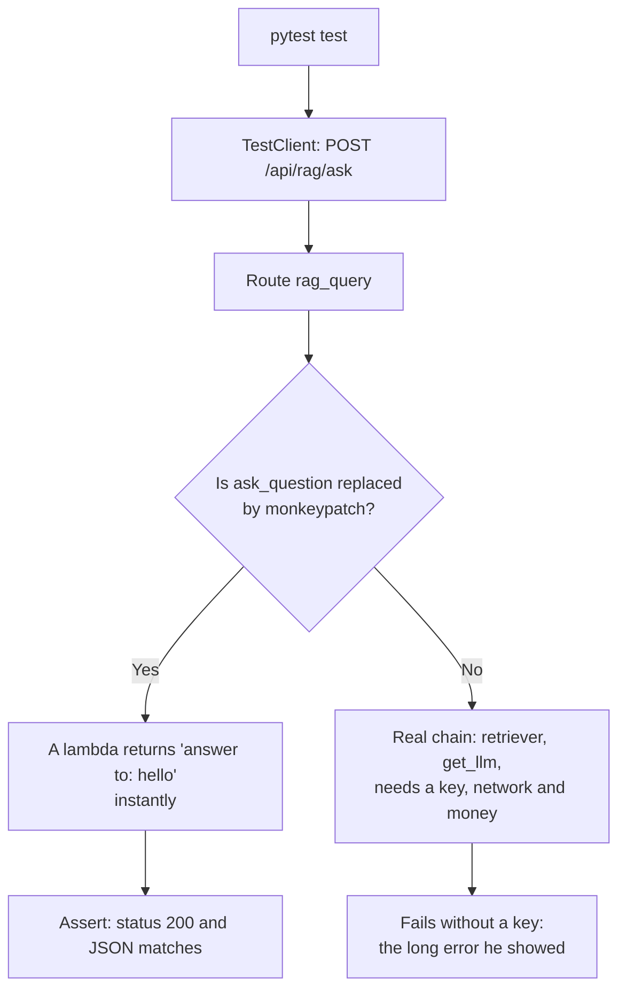
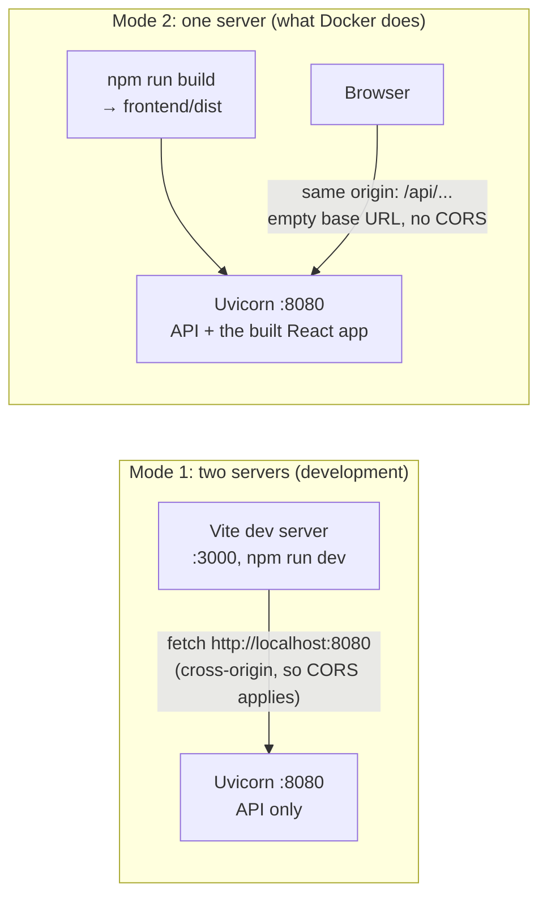
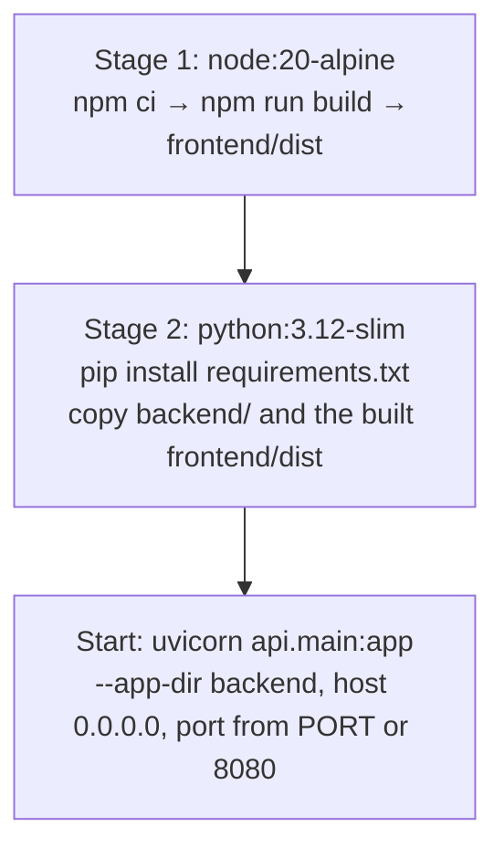

# 🚦 Meridian AI — Routes, Logs, Tests & the React Screen: Finishing Part 1 (Local)
### 📋 Agentic AI 3.0 Specialization | Krish Naik Academy

**🎙️ Mentor:** Mayank Aggarwal
**⏱️ Duration:** ~4 hours 10 minutes (recording) | **📅 Session:** Saturday, 24 October 2026
**🧩 Project:** Meridian AI (the FastAPI service in full, then logging, tests, the React screen, and a first look at Docker)

---

## 📌 Session Summary

Topics covered today:

- Recap of where the Meridian AI project stands (Part 1: local build)
- Request shapes: good and bad requests, Pydantic schemas, 422 errors
- The seven API routes and `endpoints.py` (routers, prefixes, cached supervisor)
- Health and status endpoints, and basic monitoring
- Async upload route with a thread pool
- `main.py`: lifespan, CORS, exception handlers, serving the front end
- Running the server and testing with `curl` and Swagger
- Logging: levels, structured JSON lines, handlers, `tail` and `grep`
- Testing: pytest, `TestClient`, `monkeypatch`, the 17 tests, what tests cannot prove
- The React front end: stack, `api.ts`, known gaps
- Two ways to run: two servers vs one server, plus the end-to-end demo
- Part 1 wrap-up: what the local build does and does not do
- First look at Docker (full Docker and GCP deployment starts next session)
- Live Q&A

---

## 📰 Quick Updates

- **Repo and slides are in sync.** Mayank committed all the `try_*.py` files to the `meridian-ai-learner` repo at the start of class. The test files had only been in the slide deck, so he pushed those too. If you are following along, the GitHub repo is the source of truth, and it now includes the **local-mode** work that the zip shared around 7–8 October did not have.
- **Pace is fine.** A project like this took him about a month with AI help and 2–3 months before AI. For anyone who says "I follow the code but go blank when I write from scratch": that is normal. The goal is understanding where each part lives, not memorising code.
- **Holiday:** the **7–8 November** weekend is off for Diwali.
- **Next session is cloud.** Everyone needs a working **GCP account**. Mayank will demo on his own trial account, but you will need yours.
- **Job lead:** from the job post he shared earlier, one student was shortlisted for an interview and the company will contact them directly.
- **Slide format feedback:** he asked whether the interactive slide pages beat Excalidraw sketches. His plan is to keep Excalidraw for live teaching and use the interactive pages for revision.
- **During the break** he shared free coupon links for two of his courses (one is DSA in Python) and asked for honest, non-AI-written reviews. Live attendees got these; recording viewers missed them.

---

## References
- https://github.com/mayank953/meridian-ai-learner
- https://meridian-ai-course.netlify.app/module-6#12
- https://helpme.tebra.com/Tebra_PM/12_API_and_Integration/01_Get_Started_with_Tebra_API_Integration/Tebra_API_Integration_User_Guide
---

## 🧭 Where We Stand

Mayank opened by walking the group back through the deck: the case, the project basics and setup, the "backbone" (settings, errors, logs), document Q&A (RAG), and the audit team (LangChain, tools, middleware). This session finishes **Part 1: running everything on your own machine**. Part 2 is Docker, GCP and CI/CD, and starts tomorrow.



He repeated why this project is taught so slowly: it was **built bottom-up** (one file at a time, each tried in isolation with a `try_*.py` script) and is **read top-down** (start from `main.py`, the entry point, and follow the imports downward). In later projects he will hand over finished code and ask you to read it rather than rebuild it, so this is the one where you see how the pieces are assembled.

---

## 🚪 Request Shapes: Good Requests and Bad Requests

Mayank framed the API's first job as being a good doorman. A production system serves many teams and users, so it must handle the **happy path** and the **bad path** equally well, and a bad request should be refused politely without spending any resources on it.



On the happy path FastAPI reads the type hint on the route's parameter, asks Pydantic to build the model from the JSON body, runs the route, and returns a structured reply. On the bad path the same Pydantic check fails first, FastAPI answers **422** with the field that is wrong, and none of the project's own code (or the model) is touched. The caller also learns what to fix.

### The four shapes in `api/schemas.py`

Everything entering or leaving the service is described by one of four small Pydantic models:

```python
class AuditRequest(BaseModel):
    request_text: str

class AuditResponse(BaseModel):
    risk_result: str
    tax_result: str
    control_result: str
    cfo_memo: str

class QueryRequest(BaseModel):
    query: str
    retriever_type: str = "similarity"

class QueryResponse(BaseModel):
    answer: str
```

Two points he stressed:

- **Validation runs in both directions.** A response model tells callers exactly what shape to expect, and someone downstream can validate it again because your output may be their input.
- **`retriever_type` defaults to `"similarity"`**, so a request with only `query` is valid. A request with `retriever_type` but no `query` is not.

### `try_schemas.py`: testing a file by importing it

Following the module-by-module habit from earlier classes, he pasted a small `try_schemas.py` that **imports** `QueryRequest` from `api.schemas` rather than redefining it, builds one valid request and one without `query`, and catches Pydantic's `ValidationError`. The valid case printed the query with `retriever_type` defaulting to similarity. The invalid one printed a message that `query` was missing. It needs no network or API key, which was his point: schema checking is plain Python and should never involve an LLM. (This file is not in the repo copy I could see, so no code is reproduced here.)

His broader remark: nobody interviews you on "use Pydantic". They ask how you make sure the system rejects bad input and honours its payload contract. Pydantic is simply the boilerplate answer. He also mentioned the **hexagonal (ports-and-adapters) pattern**, which he has used heavily, where input and output are validated at the outer edge. He plans to cover it in a later project.

---

## 🗺️ The Seven Routes and `endpoints.py`

The service exposes seven routes (plus one hidden alias). Each route is deliberately thin: validate, call the real logic built in earlier classes, return JSON. This is the point where earlier `try_*` scripts become something a front end can call.

| Method and path | What it does | Calls into |
|---|---|---|
| `GET /api/health` | Is the server up? Returns `{"status": "ok", "mode": ...}` | nothing |
| `GET /api/status` | Config and component summary for the status tab | settings only |
| `POST /api/agent/audit` | Runs the multi-agent procurement audit | `agent/agents.py` |
| `POST /api/rag/ask` | Answers a question from the indexed documents | `rag/retrieval.py` |
| `POST /api/rag/upload` | Accepts PDFs, stores a copy, chunks, embeds, indexes | `rag/data_ingestion.py` |
| `GET /api/rag/uploads` | Upload history for this server run | in-memory list |
| `POST /api/rag/ingest` | Indexes every PDF already in the document store | `ingest_stored_pdfs` |

(`/api/rag/ingest-gcs` is the old name for `ingest`, kept so older frontends still work and hidden from the docs.)

### How the file is set up

Four routers share prefixes, which keeps the Swagger docs grouped and lets you switch off a whole feature (for example RAG) by removing one `include_router` line:

```python
health_router = APIRouter(prefix="/api", tags=["Health"])
status_router = APIRouter(prefix="/api", tags=["Status"])
agent_router = APIRouter(prefix="/api/agent", tags=["Agent"])
rag_router = APIRouter(prefix="/api/rag", tags=["RAG"])

# In-memory upload tracker (reset on restart)
_upload_history: list[dict] = []
_server_start_time = datetime.now(timezone.utc)


@lru_cache(maxsize=1)
def get_supervisor() -> ProcurementSupervisor:
    """Build the agents on the first audit request, not when the server starts."""
    return ProcurementSupervisor()
```

Mayank pointed out the import groups (built-in, third-party, then the project's own modules) and that the same modules once imported into `try_*` scripts are now imported here. Then three details:

- **Upload history is a list in memory**, lost on restart. He said a real system would keep it in a table. The **start time** is stored so `/status` can report uptime.
- **`@lru_cache(maxsize=1)` builds the audit team once, on first use.** LRU means "least recently used" (a cache eviction policy). With a single cached value and no arguments it simply behaves as "create once, then reuse", so later requests do not rebuild the agents. Building lazily also keeps server start-up fast. (He told people to read up on LRU caches; his own answer to "why LRU instead of a plain cache?" was loose, but the build-once reading is what this code relies on.)
- **Why prefixes with tags:** they feed straight into the auto-generated API docs. He showed a real product's API documentation as the model of what clients expect, and suggested building the habit of reading docs.

### "AI is just an API call"

The audit route validates the request, runs `get_supervisor().run_audit(...)`, wraps the result in `AuditResponse`, and logs and returns a 500 if something unexpected breaks. The ask route does the same around `ask_question`. His line of the day: from the service's point of view, agents and RAG are just another API call, and everything he had built (the validation, the structured reply) is what makes that call reliable.

---

## ❤️ Health, Status and Monitoring 101

`/api/health` answers one question: *is the process up?* `/api/status` answers *what is inside it?* (mode, uptime, Python version, storage location, vector store, models, uploads this session). Neither makes any AI or Google call, deliberately: they are the endpoints other systems hit repeatedly, so they must be cheap and fast.

His scenario: a customer uploads a file and finds out *then* that your system has been down for two days. Instead, a monitor hits `/health` every few seconds or minutes and tells you first. He called this the "101 of monitoring".



- **UptimeRobot** is a hosted example. He showed the dashboard for his own hosted server: checks every 5 minutes on the free plan, uptime history, latency, and the incident from when he updated the server. A free plan covers a few sites. The service is just something that polls a URL, and you could build it yourself with a cron job; Grafana-style tools rest on the same idea.
- **In this project** the System Status screen is the polling example (he mentioned polling status every 5 seconds); he did not build alerting.
- **Load balancers** also use the health route to decide which instances get traffic.
- **Why it exists:** if someone asks "is it working?", you would not craft a dummy `/ask` payload; you would hit `/health`. He said he has built the same endpoint in every service he has worked on, including at Goldman Sachs.
- **Polling cadence and "100% availability":** polling tells you how fast you notice a failure; it does not guarantee availability.
- **Readiness and liveness probes (Vasudev's question):** Vasudev asked what happens while an app is still starting. Mayank placed those probe types in Kubernetes-style deployments and promised deeper monitoring in the next project. The relevant point for this app: orchestrators typically point their start-up, readiness or liveness checks at a route like `/api/health`, and this app answers it as soon as Uvicorn is up because the heavy objects (the audit team, the model) are built lazily.

---

## 🧵 Uploads: `async def` plus a Thread Pool

The upload route is where the file-handling care shows. He walked through it in two passes: *receive and sort*, then *store, index and clean up*.



The key code, trimmed from `api/endpoints.py`:

```python
@rag_router.post("/upload")
async def upload_documents(files: list[UploadFile] = File(...)):
    ...
    tmp_dir = tempfile.mkdtemp()
    try:
        for upload in files:
            filename = os.path.basename(upload.filename or "")
            if not filename.lower().endswith(".pdf"):
                results.append({"filename": filename, "status": "skipped",
                                "reason": "Only PDF files are supported."})
                continue

            # Save to a temp file (the async UploadFile must be awaited to read it)
            local_path = os.path.join(tmp_dir, filename)
            with open(local_path, "wb") as f:
                f.write(await upload.read())

            # Keep the original PDF (local folder or GCS). Indexing still works if this fails.
            try:
                await run_in_threadpool(document_store.save, local_path, filename)
            except Exception as store_err:
                log.warning("Could not store original file", filename=filename, error=str(store_err))

            # ingest_pdf is slow and blocking, so run it in a worker thread to keep the server responsive
            summary = await run_in_threadpool(ingest_pdf, local_path, f"upload://{filename}")
            ...
    finally:
        shutil.rmtree(tmp_dir, ignore_errors=True)
```

Why each choice was made:

- **`async def`**, because reading an upload is something you `await`, and a form can contain several files.
- **`run_in_threadpool` for the slow, blocking steps.** Chunking, embedding and indexing a 15–20 MB PDF can take a while. If it ran directly on the event loop, other users (and `/health`) would wait. In a worker thread the server keeps responding. Mayank's rule of thumb: any time-heavy operation should not block the whole application.
- **`os.path.basename`** keeps only the file name, so a name like `../x` cannot escape the temp folder.
- **Non-PDFs are reported, not crashed on:** the response lists them as `skipped` with a reason. He noted OCR would be the way to support scanned PDFs.
- **Zero chunks is also "skipped",** with a warning: the PDF may be scanned or image-only.
- **The `finally` block always removes the temp folder** even if something fails midway.

A nuance worth knowing: the plain `def` routes (`ask`, `audit`) are also safe, because FastAPI runs ordinary `def` routes in its own worker threads. The explicit `run_in_threadpool` is needed in this route because it is `async def`, where blocking calls would otherwise freeze the event loop.

**Async in general:** when asked how to decide between `async` and `def`, Mayank said `async` and `await` come as a pair, used when work can run without blocking the rest of the flow. A student asked how to wait for several files to finish in parallel and report progress; that is not handled in this version, but it is possible, and he is preparing a Python crash course on async, threads and generators for the AI era.

---

## 🏁 `main.py`: Assembling the Server

`api/main.py` is the one file that plugs everything together and turns errors into friendly replies. He pointed out the satisfaction of arriving at it last: the entry point of the app, with every earlier file feeding into it, and a shared logger "trickling" through the whole pyramid.

```python
@asynccontextmanager
async def lifespan(app: FastAPI):
    log.info("Meridian AI starting", mode=settings.app_mode, llm=settings.llm_model_name)
    yield  # the app runs here
    # Shutdown (cloud mode only): flush logs to GCS, because Cloud Run's disk disappears
    _LOGGER_INSTANCE.flush_to_gcs()


app = FastAPI(
    title=settings.app_name,
    version=settings.app_version,
    description="Multi-agent procurement audit & RAG document intelligence backend.",
    lifespan=lifespan,
)
```

- **The lifespan context manager** runs code before the app starts serving (log the mode and the LLM name) and after it stops. At shutdown in cloud mode the log file is uploaded to Google Cloud Storage, because the container's disk is thrown away. His analogy: if someone borrows your laptop and has to give it back, you save their log file to their Drive first.
- **Title and version come from settings**, not hard-coded, so one change updates the app and the docs. He also reminded people that GitHub releases and versions are a natural home for those version numbers.
- **The file does not start the server itself.** Uvicorn is told to; an `if __name__ == "__main__"` block would be the way to start it from inside the file.

### CORS: a browser-only guard

```python
app.add_middleware(
    CORSMiddleware,
    allow_origins=["*"],            # Tighten in production
    allow_credentials=True,
    allow_methods=["*"],
    allow_headers=["*"],
)
```

In development the React app runs at `http://localhost:3000` and the API at `http://localhost:8080`: different *origins* (scheme + host + port). A browser asks the server first and blocks the reply unless the server says that origin is allowed. Here the policy is wide open, a **demo setting** to tighten before real deployment. His important caveat: CORS protects *browsers only*. `curl` ignores it, so never treat CORS as your security.

### Our own errors become proper replies

```python
@app.exception_handler(ConfigurationError)
async def configuration_error(_: Request, exc: ConfigurationError):
    """A missing setting is not a crash: tell the caller exactly what to set."""
    log.error("Configuration error", error=str(exc))
    return JSONResponse(status_code=503, content={"detail": str(exc)})


@app.exception_handler(IngestionError)
async def ingestion_error(_: Request, exc: IngestionError):
    log.error("Ingestion error", error=str(exc))
    return JSONResponse(status_code=422, content={"detail": str(exc)})
```

`ConfigurationError` and `IngestionError` are the project's own exceptions (both children of `MeridianError`). The routes simply re-raise them, and these handlers translate them into a JSON reply. If you need another error type later, this is where you register it. Then the four routers are included with `include_router`, so adding or removing a feature is a one-line change.

### What the caller sees when something goes wrong

| What goes wrong | Reply |
|---|---|
| Ask with an empty `GOOGLE_API_KEY` | **503**, with a message naming the missing setting |
| Body field missing or wrong type | **422**, naming the field |
| Route that does not exist (`/api/ask2`) | **404** |
| Upload that is not a PDF | 200, listed as `skipped` with a reason |
| PDF that cannot be read | **422** (`IngestionError`) |
| Unknown `retriever_type` (for example `"banana"`) | **200**, a warning is logged and it falls back to similarity |
| Unexpected bug | **500**, logged with a traceback |

### The frontend hook at the bottom

If a built front end exists (`frontend/dist`, produced by `npm run build`), `main.py` mounts its assets and adds a **catch-all route** that serves a real file if one exists and otherwise `index.html`, so React can handle client-side routes. Anything starting with `api/` that does not match gets a 404. The route is hidden from the docs (`include_in_schema=False`), which is why Kapil could not find it in Swagger. When `dist` is missing, the app logs a warning and runs API-only. Mayank deferred the full explanation until the front end had been introduced (see below).

---

## ▶️ Running the Server and Testing Without a Front End

The command, run from the project root:

```bash
uv run uvicorn api.main:app --app-dir backend --reload --port 8080
```

He read it piece by piece: `api.main` is the module (the file `backend/api/main.py`), `:app` is the FastAPI object inside it, `--app-dir backend` says where to look for the package, `--reload` restarts on every saved Python change (development only), and `--port 8080` picks the port.

What he showed:

1. **`/api/health`** returned `status: ok` and `mode: local`. **`/api/status`** returned the backend uptime (it climbed on refresh), Python version, platform, GCP block, storage, vector search, models and ingestion counts, with no API call involved.
2. **A `curl` upload** against `/api/rag/upload` with an Aldermoor sample PDF. The first attempt failed because he gave the wrong file path, and curl said it could not read the file. The next failed with a **401 from the embedding call** because the API key he had pasted was one he had already decommissioned. After putting in a valid key and restarting, the upload went through. He liked that the failures were clear and specific, and said a back-end developer should be comfortable testing with `curl` without waiting for a front end. (The field name for the file is `files`, from the route's `files: list[UploadFile]` signature.)
3. **Swagger at `/docs`:** he executed `/api/rag/ask` with a similarity retriever and got an answer.
4. **Breaking it on purpose:** changing the path to `/api/rag/ask2` returns **404 not found**, but keeping the path and renaming the body field to `query2` returns **422** with "Field required" for `query`. Same typo-looking mistakes, very different, informative errors.

He then closed the loop on the "pyramid": the server is up, every file feeds into `main.py`, and what remained was the two things that separate a developer-level project from a production-level one: **logs** and **tests**.

---

## 📜 Logging: Reading the Server's Diary

His framing: at 2 a.m. the auditor gives a strange answer. Without a record you can only guess. Development builds the app, but **logs, files and monitoring** are what keep it running and let you debug it. A project without logging or monitoring is, in his words, not production-worthy, because failures can come from other people or circumstances, not only your code.

### What a log line looks like

Each line is a single JSON object. Every fact is its own field, so you can search for a tool name, a duration or a file name rather than parsing a sentence:

- `timestamp` (ISO format, UTC), `level`, `severity`, and `event` (the message goes last, under the name `event`), plus any extra fields you pass, like `mode` and `llm` in the startup line.
- The same JSON goes to the console locally and to Cloud Logging on the cloud, where tools can read it.

### Levels

Python's standard levels run from critical, error, warning, info, down to debug. Mayank's practice: **debug lines are for dev and UAT servers; info and above are kept in production**. When the app starts you choose the minimum level you want. Examples from this app: "Meridian AI starting" and "RAG query received" are `info`; "Unknown retriever_type, using similarity" is a `warning`; failures are `error`.

### How one line is built



The processors in `logger/custom_logger.py`, in the order the line passes through them:

```python
structlog.configure(
    processors=[
        structlog.processors.TimeStamper(fmt="iso", utc=True, key="timestamp"),
        structlog.processors.add_log_level,
        add_severity,
        structlog.processors.format_exc_info,  # log.exception(...) -> readable traceback field
        structlog.processors.EventRenamer(to="event"),
        structlog.processors.JSONRenderer()
    ],
    logger_factory=structlog.stdlib.LoggerFactory(),
    cache_logger_on_first_use=True,
)
```

| Step | What it does |
|---|---|
| `TimeStamper` | Adds an ISO UTC `timestamp` (the `Z` means UTC) |
| `add_log_level` | Adds `level`, such as `info` |
| `add_severity` | Copies the level in capitals into `severity`. Cloud Logging uses that field to colour and filter entries; `level` is kept so nothing that reads it breaks |
| `format_exc_info` | When you call `log.exception(...)`, turns the error into a text traceback field |
| `EventRenamer` | Moves the message to the end under `event` |
| `JSONRenderer` | Turns the dictionary into one line of text |

### Where each line goes

Mayank stressed *check, don't assume*. He ran the server, hit a few routes, and compared console and file:

- **Our code's lines** (`log.info(...)`) go to the **console and the log file**: the logger adds a console handler and a file handler to Python's root logger, and both print the message unchanged.
- **Library lines** (such as httpx, or the Gemini client's "automatic function calling is on" notice) pass up to the same root logger and also land in both.
- **Uvicorn's own start-up and access lines go to the console only.** Uvicorn sets up its own logger, which this course does not change. To keep access lines, read the console or redirect it to a file where you start the server.

The file lives in a `logs/` folder (created under the directory the server is started from), named by start time, for example `10_24_2026_14_05_33.log`. He showed a sample log file from the web to point out that real logs look much the same, and suggested colour or format changes are all just logging configuration. Asked about writing plain text instead of JSON (Rashim, below), he said the choice is entirely yours, and that structlog is configured in the logger file.

### Reading logs from the shell

He ran `ls logs`, then `tail` to read the end of a file (use `tail -f` to follow it live) and `grep` to find a pattern. A `grep upload` showed exactly the lines about the upload he had just done, while a grep for tool-call lines found nothing because no agent run had happened in that log. These are ordinary Linux commands. He added a warning for the AI era: a huge log pasted into an assistant can overflow its context and the assistant may miss lines, so you still need to know how to read and filter logs yourself.

On the cloud: whatever is logged goes to Cloud Logging, and the shutdown hook uploads the file to Cloud Storage. Tools like CloudWatch or tracing services sit on top of the same idea, and he said nothing beats solid basic logging.

---

## 🧪 Tests: Fast, Free and Repeatable

Mayank's case for testing: when you change something, it must not silently break other things, especially when many people work on one codebase. AI assistants will not volunteer tests by default, so you need to know what to ask for. He said he has "spent countless nights fixing tests", and always wrote his own.

### Why the tests never call Google

The rules that shaped the suite:

1. **Model calls are slow**, from a few seconds to a minute each.
2. **They cost money.** When CI/CD runs the tests on every push, real calls would turn small changes into a recurring bill.
3. **Answers differ on every run**, so a test cannot assert on them.

So the outside world (Gemini, Google Cloud, the internet) is **faked**. The tools: **pytest** (the most common Python test framework, alongside `unittest`), FastAPI's **`TestClient`**, and pytest's **`monkeypatch`**, which temporarily replaces a function or attribute for the duration of one test. He compared the idea to Mockito (Java, which he used professionally) and JUnit: the concept is *mocking a call*; each ecosystem has its own tool.

### The three files

- **`conftest.py`** sets up fake configuration before anything imports: local mode, a temp data folder, a test key, a test project, `us-central1`, and *empty* cloud settings so nothing can reach Cloud Storage. Environment variables win over `.env`, so a developer's real `.env` never leaks into a test run.
- **`test_api.py`** (9 tests) covers the routes and a few helpers.
- **`test_modes_and_middleware.py`** (8 tests) covers the local/cloud toggle, the local RAG pipeline and the agent middleware.

```python
os.environ["APP_MODE"] = "local"
os.environ["LOCAL_DATA_DIR"] = tempfile.mkdtemp(prefix="meridian-test-")
os.environ["GOOGLE_API_KEY"] = "test-key"
os.environ["GCP_PROJECT_ID"] = "test-project"
os.environ["GCP_REGION"] = "us-central1"
# Empty on purpose: nothing may try to reach Cloud Storage
os.environ["GCS_BUCKET_NAME"] = ""
```

### What the 17 tests check

| File | Tests | What they prove |
|---|---|---|
| `test_api.py` | `test_health`, `test_status_reports_local_mode_without_calling_gcp`, `test_unknown_api_route_is_404` | The server starts, health and status answer, and an unknown route is a 404 |
| | `test_ask_returns_answer`, `test_audit_returns_all_four_sections` | `/ask` and `/audit` return the right shape, with the real logic faked |
| | `test_upload_skips_non_pdf` | Only PDFs are accepted |
| | `test_chunking_splits_long_text_and_keeps_metadata`, `test_sample_pdfs_load_and_chunk` | Chunking works and the four sample PDFs load |
| | `test_log_lines_carry_a_severity_field_for_cloud_logging` | The `add_severity` step does what Cloud Logging needs |
| `test_modes_and_middleware.py` | `test_default_mode_is_local`, `test_invalid_mode_is_rejected`, `test_cloud_mode_lists_missing_settings` | The `APP_MODE` toggle and its error messages |
| | `test_missing_api_key_gives_503_not_500` | A missing key is a clean 503 |
| | `test_local_ingest_and_ask` | PDF → Chroma → retrieval → answer, offline, with fake embeddings and a fake model |
| | `test_middleware_stack_has_the_expected_layers`, `test_agent_runs_tools_through_middleware_and_redacts_email`, `test_supervisor_builds_three_agents_with_middleware` | The middleware layers exist, tools run through them, emails are redacted, three agents build |

The two tests he walked through in detail:

```python
def test_ask_returns_answer(monkeypatch):
    monkeypatch.setattr(endpoints, "ask_question", lambda query, retriever_type: f"answer to: {query}")
    res = client.post("/api/rag/ask", json={"query": "hello", "retriever_type": "similarity"})
    assert res.status_code == 200
    assert res.json() == {"answer": "answer to: hello"}


def test_upload_skips_non_pdf():
    res = client.post("/api/rag/upload", files={"files": ("notes.txt", b"hi", "text/plain")})
    assert res.json()["results"][0]["status"] == "skipped"
```

### Understanding a test by breaking it

His advice: *the best way to understand a test is to break it.*



- He **commented out the `monkeypatch` line** in the ask test. The test then failed with a much longer error, because the route went all the way down to build the real chain, which needs a retriever, embeddings and a model key that a test environment does not have. Restoring the line made it pass with no API key.
- He explained *why* faking is the right call: you are not testing Gemini, you are testing that *your endpoint* wires the request to `ask_question` and returns what it gets. The model call gets tested separately, and a change inside `get_llm` should not make an endpoint test fail or pass for the wrong reason. Running everything for real in tests is also repeated effort: the real run belongs to a proper dev or test environment.
- **The `notes.txt` demo (Anil's question):** the upload test sends `notes.txt` and expects `skipped`. Mayank changed the file to a `.pdf` and the test failed, because a PDF is no longer skipped. His point: if someone later adds `.txt` support, or removes it again, this test forces the change to be deliberate. (His live edits got a little tangled as the route returns different shapes for skipped and ingested files, but the lesson stood.)
- **A real failure during class:** after pasting in the modes-and-middleware tests, one test failed: the missing-key case that should return **503, not 500**. His in-class copy of `get_llm` had no `cache_clear`, giving an `AttributeError`. He removed that line, hit another empty-key configuration error, and kept fixing until the suite was green. In the current repo `get_llm` is wrapped in `@lru_cache(maxsize=1)`, so the test calls `llm.get_llm.cache_clear()` to reset it. His moral: **a failing test is the system working; don't move on until it passes.**
- Run output: one dot per passing test, nine from `test_api.py` and eight from the other file. The progress showed about **52%** after the first file, which is 9 of 17.

### How tests are layered

API-level tests first (is every endpoint alive?), then module-level tests (chunking, settings, logging), then tests for cross-cutting logic like middleware. He does **not** test every function. The priority is anything whose failure breaks the whole app, such as middleware and the main flows. They are mostly unit-level checks, not infrastructure or full integration tests.

### What these tests cannot tell you

- A fake model proves the **plumbing**: that the code calls the model and uses the answer. It says nothing about whether the answer is *good*. Answer quality and retrieval quality are the job of **evaluation**, a later topic.
- The front end has a single **placeholder test** that asserts `true` is `true`.
- Passing tests do **not** replace running the real app, so do a quick run at the end as well.

### Tests in the delivery pipeline

When CI/CD arrives (Part 2), a failing test blocks the deployment. On large teams the suites can take serious time: he mentioned an application with 100 to 450 engineers where tests ran 2.5 to 3 hours through Jenkins. The goal is that someone else's change cannot quietly break your code in production.

His priority statement: tests are a must-have, but a **secondary skill** at this stage because an AI assistant can write them *if you understand the backend and tell it exactly what to cover* (every module, mock external calls, create a test environment). For a deeper dive he said he might record a separate testing session if time allows, and suggested pasting the test files into an assistant and asking it to explain and improve them one at a time.

---

## 🖥️ The React Screen: Stack and `api.ts`

The pitch: people need buttons, not `curl` or Swagger. The plan was to copy a ready-made front end, read the one file that talks to the server, and run it.

**His own caveat, up front:** front end is not his strongest area. He has worked full-stack and used these tools, but a front-end engineer may spot details he gets wrong. Parts of this UI were generated with AI and reviewed by him. He will not teach front end line by line in any project. In his opinion, for an AI-engineer role the back end is what interviews probe, and the front-end specifics can be learned on the job. He added that if you do not follow the front end, that is fine; if you do not follow the back end, that is not.

### The stack

| Piece | Role |
|---|---|
| **React + TypeScript** | UI components; TypeScript is JavaScript with types added |
| **Vite** | Dev server and bundler (port 3000 in development) |
| **Node.js + npm** | Installs packages, builds and runs the front end |
| **Tailwind CSS + shadcn/ui** | Styling and accessible, pre-built components (49 UI files copied into `components/ui`) |
| **TanStack Query, React Router, Zod** | Data fetching, routing, and validation (Zod is to TypeScript what Pydantic is to Python) |
| **Vitest, Playwright, ESLint** | Unit tests, browser tests, linting |

`package.json` plays the role of `requirements.txt`: the list of dependencies with versions that `npm install` pulls in. `index.html` loads `src/main.tsx`, and the four tabs are components: `DocumentUploadTab`, `RagQATab`, `AuditTab` and `SystemStatusTab`. The Vite config also loads a design-tool plugin (`lovable-tagger`, development only) that he does not use and was not familiar with.

### `src/lib/api.ts`: the one file that talks to the server

```ts
const BASE_URL = import.meta.env.VITE_API_URL || (import.meta.env.DEV ? "http://localhost:8080" : "");

async function request<T = unknown>(path: string, options: RequestInit = {}): Promise<T> {
  const res = await fetch(`${BASE_URL}${path}`, options);
  if (!res.ok) {
    const body = await res.json().catch(() => ({}));
    throw new Error(body.detail || `HTTP ${res.status}`);
  }
  return res.json();
}

export async function askQuestion(query: string, retrieverType: string = "similarity") {
  return request<{ answer: string }>("/api/rag/ask", {
    method: "POST",
    headers: { "Content-Type": "application/json" },
    body: JSON.stringify({ query, retriever_type: retrieverType }),
  });
}
```

- **One helper for every call, one function per route.** Each knows the path, the method, the headers, and what goes in the body. The screen is built around calling these.
- **Failed replies keep the server's message.** A non-OK response becomes an `Error` carrying the server's `detail`, so the 503 sentence about the missing key reaches the screen.
- **The base URL decides the run mode** (next section).
- Front end's job, in his words: ignore how the back end is built; call the agreed routes and present the JSON nicely. The AI logic stays in the back end; the front end owns the user experience.

### Proof it is "just a curl command with a UI"

In Chrome DevTools → Network he asked a question and showed the `POST /api/rag/ask` request with its headers and JSON payload. Switching the selector to **contextual compression** changed `retriever_type` in the payload, and the call took noticeably longer because that retriever trims context with extra model calls. Indexing four PDFs produced **four separate upload calls**, one file each: the UI queues files and sends them one at a time, with the binary file in the body.

His point on matching the backend: the API accepts *several* files per request, so the screen could batch them; had the server not supported that, one call per file would be the only choice. A front end should be built in line with what the back end supports.

### Honest gaps in the screen

He pointed these out himself:

- The upload area says **up to 50 MB**, but nothing enforces it yet.
- The **progress steps are a timer** (a step is marked done after a few seconds), not real server progress. He had asked for it that way to give users a sense of progress, and said this "dummying up" is common in real products.
- There is a **"verify" label that verifies nothing**.

---

## 🔌 Two Ways to Run: Two Servers or One

This was the part he said he had never been taught in 12–13 years of watching tutorials, and it answers how front end and back end actually join.



**Mode 1: two terminals.** Terminal 1 runs the backend on 8080 (the `uv run uvicorn ...` command). Terminal 2: `cd frontend`, `npm install`, `npm run dev`, which serves the page on port 3000. The page calls the API on another port, and hot-reload lets you edit and save a file and see the change.

**Mode 2: one server.** `npm run build` in `frontend/` produces `frontend/dist`. Start only the backend and open `http://localhost:8080`: because `dist` exists, `main.py`'s catch-all serves the page *and* the API from one address. Visiting `/api/health` on the same host shows the API is right there. In this mode the base URL in `api.ts` is empty, so requests go to the same origin and **CORS is not involved**. This is exactly what Docker will do.

How `api.ts` chooses: under `npm run dev` the base URL is `http://localhost:8080`; in a built bundle it is empty, so paths like `/api/rag/ask` hit whichever host served the page. He said it is a small detail that matters, and you may not be asked in an interview, but a developer should know it.

**Pre-flight checklist before starting:** the API key is in the environment, the index and PDFs exist, the ports are free (there is a kill command to free a port if you see "already in use"), `uv` and Node are installed, you are in the project folder, and you have two terminals ready.

**Which mode is better?** Neither is wrong. Separate servers are easier to manage and scale independently, and a front end can even live on another machine; for a small app, one server avoids blocking two ports for no reason. He called the first the development setup and the second the packaged one.

### The end-to-end demo

He brought the whole thing together in the browser:

1. **Index documents.** He dragged the four sample PDFs onto the upload tab. Files were queued, processed, and listed with page and chunk counts. The **stored documents** panel shows where the originals live, and "index stored documents" re-synchronises from that folder. He also cleared the stored copy, uploaded again, and confirmed in the local files folder that the PDF landed.
2. **Ask a document question** about how production robots and tooling are depreciated (he expected 8 years from the policy). The system answered from the indexed documents, so retrieval worked end to end.
3. **Ask something unrelated:** "Who won the last NBA?" The model answered that, based on the provided context, it did not know. He treated this as an important check: not only happy cases, but the *bad* cases work, because the prompt confines answers to the retrieved context.
4. **Status tab and DevTools:** the status tab is driven by `getSystemStatus()` calling `/api/status`, and he used the Network tab to show each click producing the matching API call.

---

## 🏁 Part 1 Wrap-up: What the Local Build Does *and Does Not* Do

Mayank closed Part 1 with the project's own honest limits. Knowing the scope of improvement is what lets you direct an AI assistant to improve it:

- **Most agent tools are simulated.** Four of the five rely on the model's own knowledge; only the exchange-rate check fetches live data. A real sanctions list or credit agency would plug in behind the same tool signatures.
- **The agents never read your uploaded documents.** Document Q&A and the audit are separate features.
- **The supervisor's rules live in prompts**, not in enforced Python logic.
- **The screen over-claims** in places (see the gaps above).
- **No login, and CORS allows any site.** Upload history and memory are in-process and reset on restart.
- **Only PDFs** are supported for upload.

Because you now know the codebase, you also know which file to change for each improvement (for example, adding a further audit endpoint, or batching uploads in the front end). He encouraged everyone to **commit** at this point: the project was built file by file, and the history is a record of understanding. He also stressed: *revise Part 1 properly before moving on.* "The real learning still happens in Part 1; Part 2 is just deploying what we know."

---

## 🐳 A First Look at Docker (Part 2 starts tomorrow)

Before closing, he showed the **Dockerfile** briefly, to make the point that once you have built the project from scratch, Docker is easy to read: every line is a command you already ran by hand. His skim: set a working directory, copy `package.json` and the lock file, install, run `npm run build`; then a Python stage that copies `requirements.txt`, runs `pip install`, copies the backend into the image, exposes the port, and starts the app. Because it packs everything the app needs, it runs on any server or cloud.



The repo's Dockerfile ends like this (the start command uses `sh -c` so `${PORT}` expands, and `exec` makes Uvicorn the main process so it receives shutdown signals):

```dockerfile
EXPOSE 8080
CMD ["sh", "-c", "exec uvicorn api.main:app --app-dir backend --host 0.0.0.0 --port ${PORT:-8080}"]
```

The repo also gained a `Docker_commands.txt` after class with the build and run commands you will use tomorrow (build an image called `meridian-ai`, run it detached with `-p 8080:8080` and your `.env`, then check `docker ps`, `docker logs` and `curl http://localhost:8080/api/health`). Docs 13 and 14 in the repo cover Docker, Cloud Run, provisioning and GitHub Actions.

His slide recap for tomorrow: laptop to container, then Dockerfile, image, container and registry, with a "what is left outside the box" slide, followed by the Google Cloud explainers.

---

## 🗺️ What's Next

- **Tomorrow (Part 2):** Docker line by line (Dockerfile → image → container → registry), then Google Cloud, **provisioning resources on the go**, a **GitHub Actions deploy pipeline**, and running on **Cloud Run**. He expects the Meridian project to be finished tomorrow. You need your own **GCP account**. The Netlify slides will be updated with the complete Part 2.
- **Next project:** heavier on the back end. He will hand over the code (not build it with you) and expect you to read it first. Later projects should take about three classes, then about two, because you now understand how the code is organised, not because he is rushing.
- **Rhythm after that:** a framework one weekend, a project on it the next. A2A will be taught separately and then used in a project. He expects mostly projects for the next two months.
- **Topics he flagged for later projects:** monitoring and scaling (how much load a system handles, and how to break it to find out), prompt-injection defence (mainly in the RAG-focused project), evaluation of answer quality, the hexagonal design pattern, an async/threads/generators Python crash course, a possible microservices project (maybe on AWS), and a CRM-style project with channel integrations. He will also look into **chaos engineering / red-teaming for agents**.

---

## 💬 Live Q&A Highlights

| Question | Answer |
|---|---|
| What is UptimeRobot, and why have `/health`? | A hosted poller that hits your URL on a schedule (every 5 minutes on its free plan) and alerts you when it fails. `/health` is the cheap endpoint it checks; load balancers use it too. You could build the same with a cron job. |
| Can polling every 5 seconds guarantee 100% availability? | No. Polling interval sets how fast you notice an outage, not how available the system is. |
| Why `lru_cache` instead of a normal cache? | It builds the audit team once and reuses it. (He asked people to read up on LRU eviction; for this single-value cache the "build once, reuse" behaviour is what matters.) |
| Can we have a parent `/api` router with child routers? (Suman) | Already done: four routers share `/api` and add their own paths (`/health`, `/status`, `/agent/...`, `/rag/...`). |
| Why do status and health look like the same endpoint? | They share the `/api` prefix but have different paths: `/api/health` and `/api/status`. |
| How do controller / service / repository layers map in microservices? (Saravitri) | This app would be one service. In a microservice setup you define how services call each other. He noted a microservices project (perhaps on AWS) as a possible future topic. |
| How is the schema shared with clients? | Through FastAPI's auto-generated API docs at `/docs`, built from the Pydantic models and route tags. |
| When should I use `async`? Can I wait for several async file jobs and report progress? | `async` and `await` go together for work that should not block the flow; heavy blocking work goes in a thread. Progress for multiple files is not handled yet; there are ways, and he will cover it in a Python async crash course. |
| Why use the thread pool in upload? (Rahul) | So slow ingestion does not block the server while it works. |
| Where is the catch-all route, and why can't I see it in Swagger? (Kapil) | It is in `main.py`, hidden from docs, and only active when a built `frontend/dist` exists. It serves real files, else `index.html`. |
| Can the same service integrate WhatsApp, LinkedIn, email marketing? (Siddiq) | WhatsApp is harder; Telegram is easier. He will try such integrations if he does a CRM project. |
| Can we just get the code rather than build it? (Hitanshu) | Agreed for later: from the next project he gives the code and asks you to read it. For the first project, depth matters. |
| Why not have AI write the code live? (Murthy) | He considers live AI coding "vibe coding", not teaching. Parts of the front end were AI-written but reviewed. In his view, handing a project to an assistant without a clear structure misses things; the project took him weeks to design. |
| How do we handle prompt injection? | Covered separately in later projects, mainly the RAG one. |
| Is there an asyncio video? | Not at the depth he wants, so he is making one. |
| Will you cover chaos engineering? (jigar) | He has not studied it. His understanding: deliberately introducing failures to reveal weaknesses, applied to agents (red-teaming). He will read up and consider covering it. |
| How did you view the log files in that UI? (jigar) | It is a log-viewer app his team built (also used in his corporate training); he is not sure of the libraries. The word-wrap toggle is just an editor feature. |
| Do LLM calls remember earlier turns? Do previous embeddings go back in? (Rashim Pallavi) | LLM calls are **stateless**. For context you resend the conversation history, which may include the earlier retrieved chunks. |
| How are the logs produced in JSON? (Rashim Pallavi) | By structlog processors configured in the logger file, then written to a `.log` file as JSON lines. You can change the format to plain text; it is entirely your choice. |
| Please summarise contextual compression and multi-query. (Rashim Pallavi) | Covered in depth in the RAG session; revisit last week's recordings and slides. |
| Should production prompts be long, and can an LLM write them? (Rashim Pallavi) | Yes, you can generate prompts with an LLM, but read them and know what good prompting looks like. Don't paste blindly. |
| How do I answer "what metrics did you hit?" in interviews, using a course project? (Swati) | Interviewers ask this of experienced candidates, and they want numbers from real work. First choice: recover metrics from your actual job. Otherwise, adapt the project to your own domain and test it so the numbers (latency, load) are ones you can explain. Don't claim huge scale you cannot defend. Later projects will cover load testing and breaking the system. |
| How do chained agents pass output along? (Sonu kumar) | In this app the three audit agents are independent and run in sequence. If one depends on another, wait for the first result and inject it into the next prompt or task. Another pattern is agent-as-tool (the multi-agent pattern shown earlier). |
| Do I configure each environment (dev, test, UAT) separately? (Sonu kumar) | Today the logic hangs off `APP_MODE`. For more environments, add an environment setting and branch on it the same way. |
| Why the `try_*` files? (Sonu kumar) | They test each component on its own; they are independent modules and can be removed without affecting the app. |
| I'm rebuilding a low-code (Mendix) project with LangGraph; is that OK? (Sonu kumar) | Yes: LangGraph wraps the same ideas in a graph, where middleware and agents become nodes. Learning the concepts rather than one framework is what makes assistants like Claude and ChatGPT useful. |
| Will we get a blueprint of all back-end and front-end components at the end? | The presentation he shared already does that better. |
| Do you have a Microsoft-certified agentic AI / DevOps course? | Not yet. He is looking at a Microsoft Copilot (business-user) course and preparing content around a newly announced set of four certifications (the transcript is unclear which). He teaches courses, not certifications. |
| Should `/health` have readiness and liveness probes? (Vasudev N) | Those come with Kubernetes-style deployments; monitoring will be covered in depth in the next project. |
| The CFO approval threshold in the agent code and the controller prompt differs. (Vasudev N) | Mayank thought it was left over from local testing and never pushed. On GitHub today the expense-classification prompt in `tools.py` flags CapEx above 500,000 for CFO sign-off, while the control prompt in `prompts.py` says above €1,000,000 needs CFO plus Management Board, so worth reconciling when you read the code. |
| Why does the router group endpoints, and how does `ask_question` work? (Basavanna Olekar) | Prefix grouping helps scaling, readability and feature toggling. `ask_question` is called inside a `try`; errors from our own exception types are re-raised to the handlers. The chain is an LCEL pipeline (the pipe operator chains the steps); he noted LangChain has since moved away from LCEL, and the graph-based approach comes with LangGraph later. |
| What does line 89 in `retrieval.py` do? (Basavanna Olekar) | `build_retriever` picks a strategy from a dictionary. An unknown type logs a warning and falls back to similarity instead of raising an error; it returns a `RunnableLambda` wrapping the chosen strategy. |
| Are the 17 tests functional or infrastructure tests, and are they integration tests? (Anil) | Mostly functional checks at API and module level, not infrastructure; he called them unit tests, with the external parts mocked. They confirm endpoints are live and logic is wired, and in CI a failing test blocks the deploy. |
| Why is `notes.txt` skipped, and is that expected? (Anil) | Yes: only PDFs are supported. The test guards that, so adding `.txt` support later forces a deliberate test change. |
| What should I learn to design and develop backends like this? (Karthikeyan) | There is no single book. Learn by building several projects. LLD/HLD helps, and design patterns like hexagonal will come in later projects. Don't over-complicate. |
| Any good material on the async concepts used here, and do I need multiprocessing or only async? (Karthikeyan) | He has not found good material, so he is creating a crash course on async, await, yield, threads and related ideas in an AI context. The options are confusing (he mentioned routines in Go and Java, threading, and async/await/yield), and he will combine them for Python in that course. |
| How can I understand back-end engineering in depth? (Hardik Vora) | Future projects will be even heavier on the back end; working through them with him, and reading the code, is the route. |
| What was the `fake` code in `conftest.py`? (Hardik Vora) | Fake configuration (test key, test project, `us-central1`) so tests run with no real keys or cloud. |
| Why mock the call, when real tests are better? (Hardik Vora) | Real end-to-end tests can take minutes and cost money. Mock the expensive call, test it separately, and run full tests in a proper environment. Use `monkeypatch` in pytest (Mockito/JUnit in Java). |
| Is it OK to let AI write tests for vibe-coded code? How deep? (Hardik Vora) | Yes, if you tell it to cover each module, mock where required, and set up a test environment. Tests can also be wrong and need fixing. |
| One URL or two for front end and back end? (Hardik Vora) | Either works. Separate is easier to manage and scale; one server suits small apps. |
| My company gives only GitHub Copilot, no API keys. Can I build RAG? (Yusuf Murtaza) | RAG needs API access to a model. Without it, run a local model. Using a hosted model on company data is a data-leak risk, so ask the company to deploy a local or internal model for AI development. |
| The October zip differs from the current repo. (Yusuf Murtaza) | Use the GitHub repo: it adds local mode so you can run without a cloud subscription. |

---

## 🔑 Key Pointers to Remember

- **Refuse bad requests at the door.** Pydantic validates the body before any of your code (or any model) runs; a bad body gets a 422 naming the field.
- **Schemas work both ways.** Request and response models keep the contract honest for callers.
- **Routes stay thin.** From the service's view, an agent or a RAG chain is just one more API call.
- **Health vs status:** health says "up", status says "what's inside". Neither calls an AI. Monitors, load balancers and orchestrators poll them.
- **`@lru_cache(maxsize=1)` builds the heavy object lazily, once.**
- **Never block the event loop.** An `async def` route puts slow, blocking work (`ingest_pdf`, saving) in a thread pool.
- **Upload hygiene:** basename only, temp folder, skip non-PDFs and image-only PDFs with a reason, always clean up in `finally`.
- **Build bottom-up, read top-down.** When you meet unfamiliar code, start from `main.py`.
- **CORS is a browser rule, not security.** `curl` ignores it; `allow_origins=["*"]` is a demo setting.
- **Error codes tell a story:** 404 wrong route, 422 bad body, 503 missing configuration, 500 a bug.
- **Logs are structured:** one JSON object per line, a `severity` field for Cloud Logging, debug in dev/UAT, info and above in production.
- **Check where each log line goes:** ours to console and file, Uvicorn's to the console only. Know `tail` and `grep`.
- **Tests never call the real model.** Fake the outside, run fast, free and repeatable, and break a test on purpose to understand it.
- **A passing suite proves plumbing, not answer quality.** That needs evaluation.
- **The front end is a curl command with a UI.** `api.ts` is the only file that talks to the server; its base URL picks two-server or one-server mode.
- **Know your project's limits.** Four of five tools are simulated, no login, in-memory history, PDFs only. Being able to say that is a strength.
- **Read the code yourself.** Understanding it, not typing it, is what interviews check.

---

## ✅ Action Items After This Session

- [ ] Pull the latest `meridian-ai-learner` repo and confirm the `try_*` files and `backend/tests/` are present; commit your own file-by-file progress.
- [ ] Re-create a `try_schemas.py`: build one valid `QueryRequest` and one without `query`, catching `ValidationError`.
- [ ] Start the server: `uv run uvicorn api.main:app --app-dir backend --reload --port 8080`. Hit `/api/health` and `/api/status`, open `/docs`, and run `/api/rag/ask` from Swagger.
- [ ] Break requests on purpose: `/api/rag/ask2` (404) vs a body with `query2` (422).
- [ ] Upload a PDF with `curl`, then a `.txt`, and read the response for `ingested` vs `skipped`.
- [ ] Look at your logs: `ls logs`, `tail` the latest file, `grep upload`; confirm which lines appear in the console only.
- [ ] Run `uv run pytest backend/tests` (17 tests). Comment out the `monkeypatch` line in `test_ask_returns_answer` to see it fail, then restore it.
- [ ] Ask an assistant to explain `test_api.py` and `test_modes_and_middleware.py` one test at a time.
- [ ] Run the front end both ways: two servers (`npm run dev` on 3000 + backend on 8080) and one server (`npm run build`, then only the backend on 8080). Watch the Network tab, and switch retriever types to see the payload change.
- [ ] In the UI, ask one document question and one off-topic question and compare the answers.
- [ ] Read `frontend/src/lib/api.ts` and note how `BASE_URL` is chosen.
- [ ] Read the RAG and agent code line by line, and reconcile the CFO thresholds you find.
- [ ] Revise LRU caches, CORS, mocking and `monkeypatch`.
- [ ] Skim the Dockerfile, `Docker_commands.txt` and docs 13–14; get your **GCP account and billing** ready; install Docker if you want to follow along.
- [ ] Revise all of Part 1 before tomorrow's cloud session.

---

*📝 Notes compiled from the full 24 October 2026 session transcript and the `mayank953/meridian-ai-learner` repository (`backend/api/*`, `backend/logger/custom_logger.py`, `backend/tests/*`, `backend/try_*.py`, `frontend/src/lib/api.ts`, `frontend/vite.config.ts`, `frontend/package.json`, `Dockerfile` and `Docker_commands.txt`), "Meridian AI — Routes, Logs, Tests & the React Screen," Agentic AI 3.0 Specialization, Krish Naik Academy. The course slide site (`meridian-ai-course.netlify.app`) could not be retrieved, so slide content is taken from the recording and the repo.*
